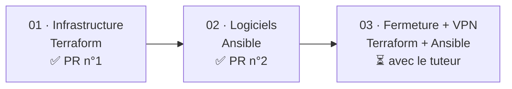
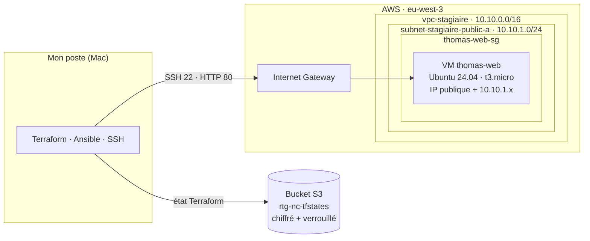
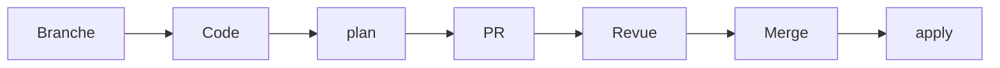
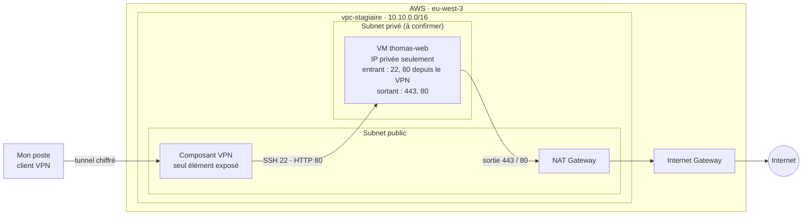
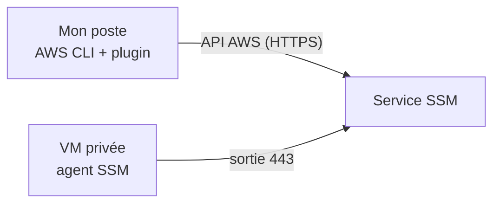
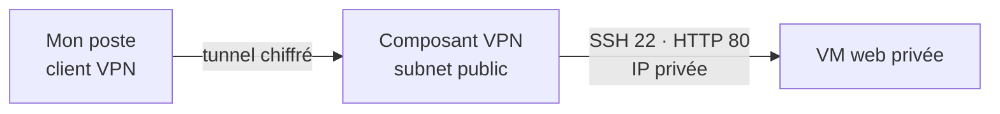
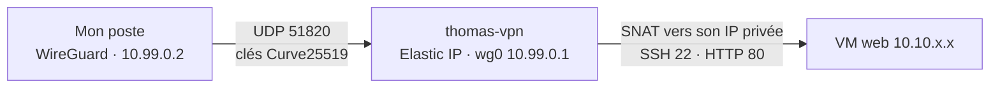
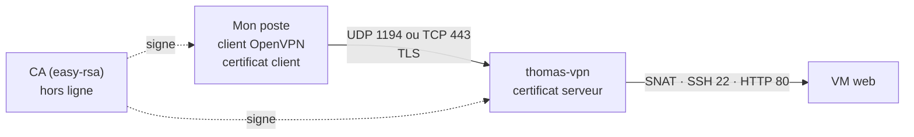
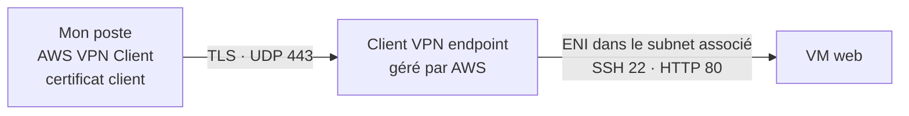
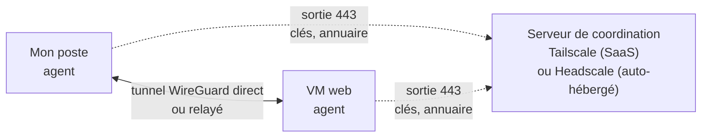

# Une VM web privée sur AWS, de Terraform à Ansible

> Alternance Retengr · Bachelor 3 Cybersécurité · Thomas Peyrusaubes
> Dépôt de code associé : `nc-private-vm-access`
> Dernière mise à jour : novembre 2026

Cette documentation retrace la construction d'une VM web sur AWS en *Infrastructure as Code*, puis sa sécurisation progressive jusqu'à ce qu'elle ne soit plus joignable depuis Internet. Elle compare trois façons d'y accéder une fois fermée (**EICE**, **SSM**, **VPN**), explique pourquoi le **VPN** est retenu, puis détaille les différentes manières de le mettre en place.

## État d'avancement

| Étape | Statut |
|---|---|
| Temps 1 · Infrastructure (Terraform) | ✅ Validé, PR n°1 |
| Temps 2 · Logiciels (Ansible) | ✅ Validé, PR n°2 |
| Corrections de revue | ✅ Validé, PR n°3 |
| Mode d'accès | ✅ VPN retenu |
| Type de VPN | ❓ À choisir avec le tuteur ([§9](#9-les-options-de-vpn)) |
| Temps 3 · Fermeture | 📝 Code proposé dans ce document, **non appliqué** |

## Sommaire

1. [Le besoin](#1-le-besoin)
2. [Point de départ : une première version trop complexe](#2-point-de-départ--une-première-version-trop-complexe)
3. [La démarche en trois temps](#3-la-démarche-en-trois-temps)
4. [Temps 1 · L'infrastructure avec Terraform](#4-temps-1--linfrastructure-avec-terraform)
5. [Temps 2 · La configuration avec Ansible](#5-temps-2--la-configuration-avec-ansible)
6. [Méthode de travail](#6-méthode-de-travail)
7. [Temps 3 · Fermer l'accès direct](#7-temps-3--fermer-laccès-direct)
8. [Accéder à une VM privée : EICE, SSM, VPN](#8-accéder-à-une-vm-privée--eice-ssm-vpn)
9. [Les options de VPN](#9-les-options-de-vpn)
10. [Durcissement complémentaire](#10-durcissement-complémentaire)
11. [Questions ouvertes pour le tuteur](#11-questions-ouvertes-pour-le-tuteur)
12. [Reproduire le projet](#12-reproduire-le-projet)
13. [Coûts et nettoyage](#13-coûts-et-nettoyage)
14. [Bilan](#14-bilan)
15. [Glossaire](#15-glossaire)
16. [Sources](#16-sources)

---

## 1. Le besoin

> « La VM ne doit jamais être joignable directement depuis Internet. La sortie vers Internet, elle, peut exister. »
> — Consigne du tuteur

| Élément | Choix |
|---|---|
| Région | `eu-west-3` (Paris) |
| Réseau | VPC partagé `vpc-stagiaire`, `10.10.0.0/16` |
| Serveur | Ubuntu 24.04, `t3.micro`, nginx |
| Accès final | **VPN** |
| Méthode | Tout en code, tout relu en Pull Request |

La consigne contient **deux contraintes distinctes** qu'il ne faut pas confondre :

- **Entrée** : personne sur Internet ne doit pouvoir ouvrir une connexion **directement** vers la VM web.
- **Sortie** : la VM, elle, doit pouvoir ouvrir des connexions vers Internet (mises à jour, dépôts de paquets).

Le mot **« directement »** est important : un accès qui passe d'abord par un intermédiaire authentifié (le VPN) respecte la consigne. C'est l'intermédiaire qui est exposé, pas la VM web.

---

## 2. Point de départ : une première version trop complexe

La première proposition (branche `ajout-vm-privee`) contenait : 2 subnets `/28`, une table de routage privée, un endpoint S3, un endpoint EICE, 3 security groups et une VM sans IP publique.

Elle était sécurisée, mais présentait trois limites :

| Limite | Explication |
|---|---|
| **CIDR écrits en dur** | Dans un VPC partagé, deux stagiaires qui créent le même subnet entrent en conflit. |
| **EICE** | Solution propriétaire AWS, refusée : l'accès doit passer par un VPN (voir [§8](#8-accéder-à-une-vm-privée--eice-ssm-vpn)). |
| **Un subnet de trop** | Le subnet dédié à l'EICE n'était pas nécessaire. |

**Leçon** : partir simple, valider, puis sécuriser étape par étape.

---

## 3. La démarche en trois temps



| Temps | Outil | Objectif | Statut |
|---|---|---|---|
| 01 · Infrastructure | Terraform | Une VM qui démarre, accessible en SSH | Validé, PR n°1 |
| 02 · Logiciels | Ansible | nginx installé et une page personnalisée, sans toucher à l'infra | Validé, PR n°2 |
| 03 · Fermeture | Terraform + Ansible | Plus d'IP publique sur la VM web, accès uniquement par le VPN | À faire avec le tuteur |

---

## 4. Temps 1 · L'infrastructure avec Terraform

### 4.1 Architecture



### 4.2 Organisation du code

| Fichier | Rôle | Contenu clé |
|---|---|---|
| `versions.tf` | Outils et état | Terraform ≥ 1.10, provider AWS `~> 6.0`, backend S3, tag `rtg-project` |
| `variables.tf` | Réglages | `region`, `my_ip` (/32), `public_key_path`, `instance_type` |
| `main.tf` | Lire et créer | 2 data sources, key pair, security group, VM |
| `outputs.tf` | Affichage | `vm_public_ip` et la commande SSH prête à copier |

> 🔒 `terraform.tfvars` contient l'IP personnelle : il est ignoré par git, aucune donnée personnelle n'est publiée.

### 4.3 Lire l'existant, ne créer que le sien

- `data` **lit** une ressource existante, sans rien créer. Terraform ne la modifiera ni ne la détruira jamais.
- `resource` **crée** une ressource, dont Terraform devient responsable.

```hcl
data "aws_subnet" "public_a" {
  filter {
    name   = "tag:Name"
    values = ["subnet-stagiaire-public-a"]
  }
}
```

Le subnet est retrouvé **par son nom**, et l'image Ubuntu par son propriétaire (Canonical) : aucun CIDR ni ID d'AMI n'est écrit en dur.

| Ressource créée | Rôle |
|---|---|
| `kp-thomas-web` | Clé SSH |
| `thomas-web-sg` | Pare-feu |
| `thomas-web` | La VM |

Chaque nom est préfixé par le prénom pour éviter les collisions dans le compte partagé.

### 4.4 Sécurité dès le premier jour

| Sens | Port | Source / destination | Pourquoi |
|---|---|---|---|
| Entrant | 22 (SSH) | `<mon_ip>/32` | Administrer la VM |
| Entrant | 80 (HTTP) | `<mon_ip>/32` | Tester le site |
| Sortant | tous | `0.0.0.0/0` | `apt`, mises à jour |

- **IMDSv2 obligatoire** : le service de métadonnées de la VM (qui délivre notamment ses identifiants IAM temporaires) exige un jeton obtenu par une requête `PUT`. Une faille web de type SSRF, qui ne sait généralement faire que des `GET`, ne peut donc plus les voler.
- **Disque chiffré** : volume `gp3` chiffré, illisible hors du compte.
- **IP publique provisoire** : acceptée au temps 1 pour tester, retirée au temps 3.
- **Sortie large** : acceptée au temps 1, restreinte au temps 3 (voir [§7.4](#74-le-code-terraform-de-la-vm-web)).

### 4.5 L'état Terraform, stocké dans S3

L'**état** (*state*) est la mémoire de Terraform : la liste des ressources qu'il a créées et leurs identifiants AWS. Sans lui, Terraform ne sait plus ce qui lui appartient.


```hcl
backend "s3" {
  bucket       = "rtg-nc-tfstates"
  key          = "stagiaire/nc-private-vm-access/..."
  region       = "eu-west-3"
  use_lockfile = true # verrou : deux apply simultanés sont impossibles
  encrypt      = true # état chiffré au repos
}
```

> ⚠️ **Leçon retenue** : ne jamais lancer `terraform init -reconfigure` sur un backend modifié. Cette option ignore l'ancien état au lieu de le migrer : Terraform repartirait d'un état vide, « oublierait » les ressources déjà créées et tenterait de les recréer en double.

---

## 5. Temps 2 · La configuration avec Ansible

### 5.1 Le playbook `site.yml`

| Tâche | Module | Effet |
|---|---|---|
| 1 | `apt` | Installer nginx (`update_cache`, `cache_valid_time: 3600`) |
| 2 | `service` | Démarrer et activer nginx (`state: started`, `enabled: true`) |
| 3 | `copy` | Personnaliser la page : « Bonjour, je suis Thomas Peyrusaubes » |

`cache_valid_time: 3600` évite de relancer `apt update` si le cache a moins d'une heure : le playbook reste rapide et idempotent.

### 5.2 Adaptation d'Amazon Linux vers Ubuntu 24.04

| Élément | Amazon Linux | Ubuntu 24.04 |
|---|---|---|
| Utilisateur | `ec2-user` | `ubuntu` |
| Paquets | `dnf` | `apt` |
| Page par défaut | `/usr/share/nginx/html/index.html` | `/var/www/html/index.nginx-debian.html` |

### 5.3 Résultats : l'idempotence

| Exécution | Résultat | Signification |
|---|---|---|
| 1re | `changed=2` | nginx installé, page remplacée |
| 2e | `changed=0` | Tout est déjà en place, rien à refaire |
| Test | `200 OK` | `curl` : nginx/1.24.0 sert la page, vérifié par le tuteur |

**Idempotence** : on peut relancer le playbook sans risque, il ne fait que ce qui manque.

---

## 6. Méthode de travail



| Outil | Règle | Raison |
|---|---|---|
| **Terraform** | `apply` uniquement après revue et merge | Il crée des ressources payantes : une erreur peut coûter cher |
| **Ansible seul** | Test possible tout de suite, PR en parallèle | Il n'installe que des logiciels |

Messages de commit au format `type(scope): description`, en anglais. Exemple : `feat(ansible): install nginx`.

---

## 7. Temps 3 · Fermer l'accès direct

### 7.1 Ce qui change pour la VM web

| Élément | Avant (temps 1) | Après (temps 3) |
|---|---|---|
| IP publique | oui | **aucune** |
| Subnet | public | **privé** |
| SSH (22) entrant | depuis mon IP | **uniquement depuis le VPN** |
| HTTP (80) entrant | depuis mon IP | **uniquement depuis le VPN** |
| Sortie | tous ports, via l'IGW | **443 et 80 uniquement, via une NAT** |
| Accès admin | SSH direct | **SSH à travers le VPN**, vers l'IP privée |

Retirer l'IP publique et changer de subnet obligent AWS à **recréer la VM** : elle redémarre vierge, et le playbook Ansible la reconfigure (c'est tout l'intérêt de l'idempotence).

### 7.2 Le piège : la sortie Internet disparaît avec l'IP publique

Une **Internet Gateway** ne fait sortir une VM vers Internet que si celle-ci possède une **IP publique**. Sans IP publique, même dans un subnet public, et même avec une règle sortante ouverte dans le security group, **la VM n'a plus aucun chemin vers Internet** : plus d'`apt`, plus de mises à jour de sécurité.

> Le security group décide **si** un trafic est autorisé ; la table de routage décide **par où** il passe. Une règle sortante ouverte ne sert à rien s'il n'existe aucune route.

Le VPN ne règle pas ce problème : il sert à **entrer**, pas à faire sortir la VM. Il faut donc une solution de sortie **en plus** du VPN :

| Solution | Principe | Donne accès à | Coût indicatif (eu-west-3) |
|---|---|---|---|
| **NAT Gateway** | La VM est placée dans un subnet privé. Sa route `0.0.0.0/0` pointe vers une NAT, elle-même dans un subnet public. La NAT laisse sortir mais **refuse toute connexion initiée depuis l'extérieur**. | Internet + services AWS | ~0,05 $/h + ~0,05 $/Go traité, soit ~36 $/mois minimum |
| **VPC Endpoints** (interface) | Une interface réseau privée, dans le VPC, pour chaque service AWS utilisé. | Services AWS **uniquement** (pas d'`apt`) | ~0,01 $/h par endpoint et par AZ |

**Choix retenu : la NAT**, car c'est la seule qui permet à `apt` de fonctionner, comme le demande la consigne.

> 💡 Avec un VPN auto-hébergé, le serveur VPN pourrait aussi servir de NAT pour la VM web (on parle d'*instance NAT*). C'est moins cher, mais cela mélange deux rôles sur une seule machine exposée : si elle tombe, l'accès **et** la sortie tombent ensemble. Cette option n'est pas retenue.

### 7.3 Architecture cible

L'architecture est la même quel que soit le VPN choisi : seul le bloc « Composant VPN » change ([§9](#9-les-options-de-vpn)).



Lecture :

- **Entrée** : la seule porte vers la VM web est le composant VPN, qui exige une authentification forte (clé ou certificat) avant de laisser passer quoi que ce soit.
- **Sortie** : la VM sort par la NAT, qui ne laisse rien entrer.
- **Rien sur Internet ne peut joindre la VM web directement** : elle n'a pas d'IP publique et son subnet n'a pas de route vers l'Internet Gateway.

### 7.4 Le code Terraform de la VM web

> 📝 **Proposition, non appliquée.** Elle dépend des réponses du tuteur ([§11](#11-questions-ouvertes-pour-le-tuteur)), notamment du nom du subnet privé et du type de VPN. Elle suivra le circuit habituel : branche, `plan`, PR, revue, merge, `apply`.

Cette partie est **commune à tous les VPN**. Le code propre à chaque VPN est au [§9](#9-les-options-de-vpn).

**`variables.tf`** : le subnet privé est lu par son nom, comme au temps 1. `my_ip` n'est plus utile pour la VM web.

```hcl
variable "private_subnet_name" {
  description = "Name tag of the existing private subnet"
  type        = string
  default     = "subnet-stagiaire-private-a" # nom à confirmer avec le tuteur
}
```

**`main.tf`** : lecture du subnet privé.

```hcl
data "aws_subnet" "private_a" {
  filter {
    name   = "tag:Name"
    values = [var.private_subnet_name]
  }
}
```

**`main.tf`** : le security group de la VM web.

```hcl
resource "aws_security_group" "web" {
  name        = "thomas-web-sg"
  description = "Thomas web VM reachable only through VPN" # sans apostrophe (voir Bilan)
  vpc_id      = data.aws_subnet.private_a.vpc_id

  ingress {
    description     = "SSH from VPN only"
    from_port       = 22
    to_port         = 22
    protocol        = "tcp"
    security_groups = [aws_security_group.vpn.id] # défini au §9, selon le VPN
  }

  ingress {
    description     = "HTTP from VPN only"
    from_port       = 80
    to_port         = 80
    protocol        = "tcp"
    security_groups = [aws_security_group.vpn.id]
  }

  egress {
    description = "HTTPS for updates"
    from_port   = 443
    to_port     = 443
    protocol    = "tcp"
    cidr_blocks = ["0.0.0.0/0"]
  }

  egress {
    description = "HTTP for apt repositories"
    from_port   = 80
    to_port     = 80
    protocol    = "tcp"
    cidr_blocks = ["0.0.0.0/0"]
  }
}
```

**Pourquoi une source `security_groups` et pas une plage d'IP** : la règle dit « tout ce qui porte le SG du VPN », quelle que soit son IP. Si le serveur VPN est recréé et change d'IP privée, la règle reste valable. C'est aussi plus lisible en revue : on voit **qui** a le droit d'entrer, pas seulement une adresse.

**Pourquoi ça fonctionne avec tous les VPN** : dans les quatre options du [§9](#9-les-options-de-vpn) configurées comme proposé, le trafic qui arrive sur la VM web a pour **source l'interface réseau du composant VPN** (le VPN fait de la traduction d'adresse, *SNAT*). La VM web voit donc arriver le composant VPN, jamais directement mon poste.

**Pourquoi seulement 443 et 80 en sortie** :

| Port | Utilisé par |
|---|---|
| 443 (HTTPS) | Mises à jour, API éventuelles |
| 80 (HTTP) | Dépôts `apt` d'Ubuntu (les paquets sont signés, le HTTP n'est pas un risque d'intégrité) |
| DNS, NTP | **Rien à ouvrir** : le trafic vers le résolveur DNS d'AWS et son service NTP (`169.254.169.123`) n'est pas filtré par les security groups |

Les réponses aux connexions SSH et HTTP venant du VPN n'ont pas besoin de règle sortante : un security group est **à état**, il laisse repartir automatiquement la réponse d'une connexion qu'il a acceptée.

> ℹ️ Modifier la `description` d'un security group force Terraform à le **détruire et le recréer**. Ici ce n'est pas gênant puisque la VM est recréée de toute façon.

**`main.tf`** : la VM.

```hcl
resource "aws_instance" "web" {
  # ... ami, instance_type, key_name, IMDSv2, disque chiffré : inchangés

  subnet_id                   = data.aws_subnet.private_a.id
  associate_public_ip_address = false
  vpc_security_group_ids      = [aws_security_group.web.id]
}
```

**`outputs.tf`** : l'IP publique n'existe plus, on affiche l'IP privée, utilisée à travers le VPN.

```hcl
output "vm_private_ip" {
  value = aws_instance.web.private_ip
}

output "ssh_command" {
  value = "ssh -i ~/.ssh/thomas-web ubuntu@${aws_instance.web.private_ip} # VPN connecté"
}
```

### 7.5 Prouver que la VM est fermée

Ces vérifications sont à exécuter après l'`apply` et à joindre à la PR, au même titre que le `changed=0` du temps 2.

**Rien ne peut entrer directement**

**1. La VM web n'a pas d'IP publique.**

```bash
aws ec2 describe-instances --instance-ids <instance_id> \
  --query "Reservations[].Instances[].PublicIpAddress" --output text
```

Résultat attendu : **vide**.

**2. Le security group n'accepte que le VPN.**

```bash
aws ec2 describe-security-groups --filters Name=group-name,Values=thomas-web-sg \
  --query "SecurityGroups[].IpPermissions[].{port:FromPort,ip:IpRanges,sg:UserIdGroupPairs[].GroupId}"
```

Résultat attendu : ports 22 et 80, `ip` **vide**, `sg` = l'ID du SG du VPN.

**3. Le subnet de la VM n'a aucune route directe vers l'Internet Gateway.**

```bash
aws ec2 describe-route-tables \
  --filters Name=association.subnet-id,Values=<subnet_id> \
  --query "RouteTables[].Routes[]"
```

Résultat attendu : la route `0.0.0.0/0` pointe vers un `nat-…`, **jamais vers un `igw-…`**.

**4. Sans VPN, la VM est injoignable.** VPN **déconnecté**, depuis mon poste :

```bash
curl --max-time 5 http://<ip_privee_vm>
```

Résultat attendu : **échec** (délai dépassé). Une IP privée n'est pas routable sur Internet.

**Tout fonctionne quand même**

**5. Avec le VPN, la VM répond.** VPN **connecté** :

```bash
curl -s http://<ip_privee_vm> | grep Thomas
ssh -i ~/.ssh/thomas-web ubuntu@<ip_privee_vm> hostname
```

Résultat attendu : la page « Bonjour, je suis Thomas Peyrusaubes », puis le nom de la VM.

**6. La VM sort bien par la NAT.** Depuis la session SSH :

```bash
curl -sI https://archive.ubuntu.com | head -1
```

Résultat attendu : une réponse HTTP (`200` ou une redirection).

La comparaison des points 4 et 5 est la preuve la plus parlante : **même commande, même cible, seul le VPN change le résultat**.

Les preuves propres au composant VPN (seul port exposé, authentification) sont au [§9](#9-les-options-de-vpn).

---

## 8. Accéder à une VM privée : EICE, SSM, VPN

Une fois la VM fermée, il faut un moyen d'entrer pour l'administrer. Trois approches ont été étudiées.

### 8.1 EICE · EC2 Instance Connect Endpoint

**Principe** : un endpoint géré par AWS, placé dans le VPC, ouvre un tunnel TCP entre le poste et le port 22 de la VM. L'authentification passe par IAM (action `ec2-instance-connect:OpenTunnel`).


| ✅ Avantages | ❌ Limites |
|---|---|
| Gratuit | Propriétaire AWS, non transférable |
| Pas d'IP publique ni de bastion | Le port 22 reste ouvert sur la VM |
| Authentification IAM | Gestion de clés SSH toujours nécessaire |

**Écarté** : solution propriétaire AWS, refusée par le tuteur.

### 8.2 SSM Session Manager

**Principe** : la logique est inversée. L'**agent SSM** installé sur la VM ouvre une connexion sortante HTTPS vers le service SSM et la maintient. Les sessions passent par ce canal déjà ouvert : **la VM n'accepte aucune connexion entrante**.



| ✅ Avantages | ❌ Limites |
|---|---|
| Zéro port entrant, zéro exposition | Propriétaire AWS |
| Accès contrôlé par IAM | Dépend d'une sortie (NAT ou endpoints) |
| Sessions journalisables | Rôle IAM sur la VM et plugin sur le poste |
| Gratuit | Compétence non transférable hors AWS |

**Non retenu** : techniquement le plus fermé, mais propriétaire AWS. Le VPN a été préféré pour son caractère standard.

### 8.3 VPN

**Principe** : un tunnel chiffré relie mon poste au VPC. Une fois le tunnel monté, mon poste peut joindre les IP privées du VPC (`10.10.x.x`) comme s'il était sur le même réseau local. Avant le tunnel, ces IP sont injoignables.



| ✅ Avantages | ❌ Limites |
|---|---|
| Technologie standard, utilisable hors AWS | Un point d'entrée reste exposé sur Internet |
| Accès réseau complet aux IP privées | Un composant de plus à maintenir ou à payer |
| Ansible fonctionne sans adaptation | Clés ou certificats VPN à gérer, en plus des clés SSH |

**Un point d'entrée reste exposé** : c'est le compromis du VPN. On ne supprime pas la surface d'attaque, on la **concentre** sur un seul composant, conçu pour ça, qui exige une authentification cryptographique avant de répondre.

### 8.4 Comparatif

| Critère | EICE | SSM | VPN |
|---|---|---|---|
| Port entrant sur la VM web | 22 (depuis l'endpoint) | aucun | 22/80 (depuis le VPN) |
| Élément exposé sur Internet | aucun | aucun | le composant VPN |
| Authentification | IAM + clé SSH | IAM | clé ou certificat VPN + clé SSH |
| Portabilité hors AWS | non | non | **oui** |
| Ansible | oui | oui (ProxyCommand) | **oui, direct** |
| Conforme à la consigne | ❌ refusé | ✅ | ✅ |

### 8.5 Décision : le VPN

Le **VPN** est retenu. Sa logique (un réseau privé et une porte d'entrée authentifiée) est la même dans tous les environnements : AWS, autre cloud ou réseau d'entreprise. Il reste à choisir **quel** VPN, ce que détaille la section suivante.

---

## 9. Les options de VPN

« Un VPN » recouvre des solutions très différentes. Quatre options sont réalistes pour ce projet.

| # | Option | En une phrase |
|---|---|---|
| A | **WireGuard auto-hébergé** | Je monte mon propre serveur VPN moderne sur une petite VM. |
| B | **OpenVPN auto-hébergé** | Pareil, avec le VPN historique, plus lourd mais très répandu. |
| C | **AWS Client VPN** | AWS fournit et maintient le serveur VPN, je paie à l'heure. |
| D | **VPN maillé (Tailscale / Headscale)** | Un agent sur chaque machine, coordonné par un service central. |

Le **Site-to-Site VPN** d'AWS n'est pas retenu : il relie un réseau d'entreprise entier (avec un routeur compatible) au VPC, pas un poste individuel.

### 9.A WireGuard auto-hébergé

**Principe** : une petite VM Ubuntu dans le subnet public fait tourner WireGuard. Chaque poste client possède une **paire de clés** ; le serveur connaît la clé publique de chaque client autorisé (un *peer*). Une clé inconnue ne reçoit **aucune réponse** : le port semble fermé.



**Ce qu'il faut créer**

| Élément | Où | Rôle |
|---|---|---|
| VM `thomas-vpn` (`t3.micro` ou `t4g.nano`) | Subnet public | Le serveur VPN |
| Elastic IP | Attachée à `thomas-vpn` | Adresse publique **fixe** : la config client ne change pas si la VM redémarre |
| SG `thomas-vpn-sg` | Sur `thomas-vpn` | Entrée : **UDP 51820 uniquement** |
| Réseau du tunnel | `10.99.0.0/24` | Adresses internes du VPN. Ne doit chevaucher **ni** le VPC (`10.10.0.0/16`) **ni** le réseau de la maison (souvent `192.168.x.x`) |
| Rôle Ansible `wireguard` | Sur `thomas-vpn` | Installation, clés, configuration, routage |

**Terraform**

```hcl
resource "aws_security_group" "vpn" {
  name        = "thomas-vpn-sg"
  description = "Thomas WireGuard server"
  vpc_id      = data.aws_subnet.public_a.vpc_id

  ingress {
    description = "WireGuard"
    from_port   = 51820
    to_port     = 51820
    protocol    = "udp"
    cidr_blocks = ["0.0.0.0/0"] # ou <mon_ip>/32 si mon IP est fixe
  }

  egress {
    description = "SSH to the private subnet"
    from_port   = 22
    to_port     = 22
    protocol    = "tcp"
    cidr_blocks = [data.aws_subnet.private_a.cidr_block] # lu, pas écrit en dur
  }

  egress {
    description = "HTTP to the private subnet"
    from_port   = 80
    to_port     = 80
    protocol    = "tcp"
    cidr_blocks = [data.aws_subnet.private_a.cidr_block]
  }

  egress {
    description = "HTTPS for updates"
    from_port   = 443
    to_port     = 443
    protocol    = "tcp"
    cidr_blocks = ["0.0.0.0/0"]
  }

  egress {
    description = "HTTP for apt repositories"
    from_port   = 80
    to_port     = 80
    protocol    = "tcp"
    cidr_blocks = ["0.0.0.0/0"]
  }
}

resource "aws_instance" "vpn" {
  ami                         = data.aws_ami.ubuntu.id
  instance_type               = "t3.micro"
  subnet_id                   = data.aws_subnet.public_a.id
  vpc_security_group_ids      = [aws_security_group.vpn.id]
  key_name                    = aws_key_pair.web.key_name # la clé kp-thomas-web existante
  associate_public_ip_address = false # l'Elastic IP la remplace
  # IMDSv2 et disque chiffré : comme la VM web
  tags = { Name = "thomas-vpn" }
}

resource "aws_eip" "vpn" {
  instance = aws_instance.vpn.id
  tags     = { Name = "thomas-vpn-eip" }
}
```

Points d'attention :

- La règle d'entrée `0.0.0.0/0` sur UDP 51820 est **acceptable** : WireGuard ne répond qu'aux clés connues, un scan ne voit rien. La restreindre à mon IP est plus strict, mais impossible si mon IP change (box, 4G, iCloud Private Relay).
- La sortie vers le subnet privé est limitée à 22 et 80, en **deux règles séparées** : une seule règle « de 22 à 80 » ouvrirait aussi tous les ports intermédiaires (23, 25, 53…).
- **Aucune règle SSH entrante depuis Internet** sur `thomas-vpn` : il s'administre lui-même **à travers le tunnel**, via son adresse `10.99.0.1`.

**Le problème de l'œuf et de la poule** : pour configurer WireGuard avec Ansible, il faut se connecter en SSH au serveur… qui n'est joignable qu'une fois WireGuard configuré. Deux solutions :

| Solution | Principe | Avis |
|---|---|---|
| **cloud-init** (`user_data`) | Terraform passe un script exécuté au premier démarrage, qui installe WireGuard et ajoute ma clé publique de client. | Propre : aucun port SSH ouvert, jamais. |
| **SSH temporaire** | Une règle SSH depuis `<mon_ip>/32` le temps du premier playbook, retirée ensuite par une nouvelle PR. | Simple, mais une fenêtre d'exposition et deux PR. |

**Configuration (rôle Ansible `wireguard`)**

| Étape | Commande ou fichier | Pourquoi |
|---|---|---|
| Installer | `apt: name=wireguard` | Le module est intégré au noyau Linux depuis la version 5.6 |
| Générer les clés **sur le serveur** | `wg genkey \| tee privatekey \| wg pubkey > publickey` | La clé privée ne quitte jamais le serveur et n'entre jamais dans git |
| Activer le routage | `net.ipv4.ip_forward = 1` (sysctl) | Le serveur doit relayer des paquets qui ne lui sont pas destinés |
| Traduire les adresses | `PostUp = iptables -t nat -A POSTROUTING -o ens5 -j MASQUERADE` dans `wg0.conf` | Les paquets du tunnel ressortent avec l'IP privée du serveur : la VM web voit `thomas-vpn`, ce qui correspond à la règle `security_groups` du [§7.4](#74-le-code-terraform-de-la-vm-web) |
| Déclarer chaque client | Un bloc `[Peer]` avec sa clé publique et son IP (`10.99.0.2/32`) | Un client = une clé. Révoquer quelqu'un = supprimer son bloc |
| Démarrer | `systemctl enable --now wg-quick@wg0` | Le tunnel redémarre avec la VM |

L'interface réseau s'appelle `ens5` sur les instances AWS récentes. À vérifier avec `ip -br link`.

**Configuration côté poste** (`thomas-mac.conf`, jamais commité) :

```ini
[Interface]
PrivateKey = <clé privée du Mac, générée sur le Mac>
Address    = 10.99.0.2/32

[Peer]
PublicKey           = <clé publique du serveur>
Endpoint            = <elastic_ip>:51820
AllowedIPs          = 10.99.0.0/24, 10.10.0.0/16
PersistentKeepalive = 25
```

| Ligne | Effet |
|---|---|
| `AllowedIPs` | **Tunnel partiel** (*split tunnel*) : seul le trafic vers le tunnel et le VPC passe par le VPN. Ma navigation Internet ne change pas. Mettre `0.0.0.0/0` ferait passer **tout** mon trafic par AWS. |
| `PersistentKeepalive = 25` | Un petit paquet toutes les 25 s maintient le tunnel ouvert à travers la box ou un pare-feu. |

**Preuves propres à WireGuard**

```bash
sudo wg show                               # sur le serveur : "latest handshake" récent pour mon peer
nc -vz -w 3 <elastic_ip> 22                # depuis Internet : échec, SSH non exposé
nmap -sU -p 51820 <elastic_ip>             # "open|filtered" : WireGuard ne répond pas à un inconnu
```

**Bilan de l'option A**

| ✅ Avantages | ❌ Limites |
|---|---|
| Très peu de code, cryptographie moderne et figée (pas de choix d'algorithme à mal faire) | Une VM exposée à maintenir : mises à jour, surveillance |
| Rapide, intégré au noyau Linux | Gestion manuelle des clés de chaque client |
| Ne répond pas aux inconnus : invisible aux scans | Pas d'annuaire ni de SSO : un peer = une clé |
| Peu cher, compétence transférable partout | Si la VM tombe, plus d'accès |
| **Coût : ~14 $/mois** (VM + IP publique) | |

### 9.B OpenVPN auto-hébergé

**Principe** : même architecture que WireGuard (une VM dans le subnet public), mais avec OpenVPN. L'authentification repose sur une **PKI** : une autorité de certification (CA) signe un certificat pour le serveur et un pour chaque client.



**Ce qui change par rapport à WireGuard**

| Élément | WireGuard | OpenVPN |
|---|---|---|
| Port | UDP 51820 | UDP 1194, ou **TCP 443** |
| Authentification | Paires de clés | Certificats X.509 signés par une CA |
| Révocation | Supprimer le bloc `[Peer]` | Liste de révocation (CRL) à publier sur le serveur |
| Configuration | ~15 lignes | Plusieurs centaines d'options |
| Performance | Très élevée (noyau) | Correcte (espace utilisateur) |

**Le vrai avantage d'OpenVPN : le mode TCP 443.** Certains réseaux (entreprise, hôtel, école) bloquent l'UDP. OpenVPN sur TCP 443 ressemble à du trafic HTTPS et passe presque partout.

**La CA doit rester hors du serveur** : si le serveur VPN est compromis et que la clé de la CA s'y trouve, l'attaquant peut signer ses propres certificats clients.

**Bilan de l'option B**

| ✅ Avantages | ❌ Limites |
|---|---|
| Standard historique, clients sur toutes les plateformes | Configuration longue, nombreux réglages à mal faire |
| TCP 443 traverse les réseaux restrictifs | PKI à gérer : CA, certificats, révocation |
| Compatible avec le client d'AWS Client VPN | VM exposée à maintenir, comme WireGuard |
| **Coût : ~14 $/mois** | Répond aux connexions TLS : détectable par un scan |

### 9.C AWS Client VPN

**Principe** : AWS fournit un serveur OpenVPN **géré**. Je crée un *endpoint* Client VPN, je l'associe à un subnet, et AWS s'occupe des serveurs, de leur disponibilité et de leurs mises à jour. Il n'y a aucune VM à maintenir.



**Ce qu'il faut créer**

| Élément | Rôle |
|---|---|
| Certificat serveur et CA, importés dans **ACM** | Générés avec `easy-rsa`, comme pour OpenVPN |
| `aws_ec2_client_vpn_endpoint` | Le VPN lui-même : authentification, plage client, journalisation |
| `aws_ec2_client_vpn_network_association` | Rattache le VPN à un subnet : c'est **cette association qui est facturée à l'heure** |
| `aws_ec2_client_vpn_authorization_rule` | Qui a le droit d'atteindre quel réseau (ici `10.10.0.0/16`) |
| SG `thomas-vpn-sg` | Attaché à l'endpoint, référencé par le SG de la VM web |

**Terraform (extrait)**

```hcl
resource "aws_ec2_client_vpn_endpoint" "this" {
  description            = "thomas-client-vpn"
  server_certificate_arn = aws_acm_certificate.server.arn
  client_cidr_block      = "10.99.0.0/22" # au minimum /22, sans chevauchement avec le VPC
  split_tunnel           = true           # seul le trafic vers le VPC passe par le VPN
  vpc_id                 = data.aws_subnet.private_a.vpc_id
  security_group_ids     = [aws_security_group.vpn.id]

  authentication_options {
    type                       = "certificate-authentication"
    root_certificate_chain_arn = aws_acm_certificate.ca.arn
  }

  connection_log_options {
    enabled               = true
    cloudwatch_log_group  = aws_cloudwatch_log_group.vpn.name
  }
}

resource "aws_ec2_client_vpn_network_association" "this" {
  client_vpn_endpoint_id = aws_ec2_client_vpn_endpoint.this.id
  subnet_id              = data.aws_subnet.private_a.id
}

resource "aws_ec2_client_vpn_authorization_rule" "vpc" {
  client_vpn_endpoint_id = aws_ec2_client_vpn_endpoint.this.id
  target_network_cidr    = "10.10.0.0/16"
  authorize_all_groups   = true
}
```

Points d'attention :

- **Le coût court dès que le subnet est associé**, même sans aucune connexion. Pour un projet de stage, on peut supprimer l'association en dehors des séances de travail (`terraform destroy -target=...`), au prix d'une manipulation à chaque fois.
- La journalisation des connexions (qui, quand, depuis quelle IP) est **intégrée** et envoyée à CloudWatch : c'est un vrai plus pour l'audit.
- L'authentification peut aussi passer par un annuaire (Active Directory) ou un fournisseur SSO (SAML), avec MFA. En certificat seul, la révocation passe par une CRL importée sur l'endpoint.

**Bilan de l'option C**

| ✅ Avantages | ❌ Limites |
|---|---|
| Aucune VM à maintenir ni à patcher | **Cher : ~73 $/mois** au repos + ~0,05 $/h par connexion |
| Haute disponibilité gérée par AWS | Propriétaire AWS (le protocole, lui, est OpenVPN) |
| Journal des connexions intégré | PKI à gérer quand même (certificats dans ACM) |
| SSO et MFA possibles | Plage client en `/22` minimum : beaucoup d'adresses réservées |

### 9.D VPN maillé : Tailscale ou Headscale

**Principe** : on n'installe pas « un serveur VPN » mais un **agent** sur chaque machine (mon Mac, la VM web). Un **serveur de coordination** distribue les clés WireGuard et l'annuaire ; les machines se connectent ensuite **directement entre elles**, en WireGuard.



**Particularité majeure** : comme avec SSM, **aucun port entrant n'est nécessaire**. Les deux agents se connectent vers l'extérieur et traversent les NAT par une technique de « perçage » (*NAT traversal*). Si c'est impossible, le trafic passe par un relais, toujours chiffré de bout en bout.

| Variante | Serveur de coordination | Avantage | Limite |
|---|---|---|---|
| **Tailscale** | Service commercial (SaaS) | Mise en place en quelques minutes, SSO intégré, gratuit pour un usage personnel | **Un tiers externe** contrôle qui peut rejoindre le réseau. À valider avec l'entreprise. |
| **Headscale** | Logiciel libre, hébergé soi-même | Aucune dépendance à un tiers | Retour à une VM exposée à maintenir (la coordination) |

**Ce qui change dans le code** : pas de serveur VPN dans AWS (avec Tailscale), mais un agent à installer par Ansible sur la VM web, avec une clé d'enrôlement à usage unique stockée hors de git. Le SG de la VM web n'a alors **plus besoin d'aucune règle entrante**, comme avec SSM.

**Bilan de l'option D**

| ✅ Avantages | ❌ Limites |
|---|---|
| Aucun port entrant, ni sur la VM ni ailleurs (Tailscale) | Dépendance à un service tiers (Tailscale) |
| Basé sur WireGuard | Agent à installer sur chaque machine cible |
| Gestion des accès par identité (SSO), révocation en un clic | Modèle différent des VPN classiques, moins standard en entreprise |
| Gratuit en usage personnel (Tailscale) | Validation sécurité de l'entreprise nécessaire |

### 9.E Comparatif des options

| Critère | A · WireGuard | B · OpenVPN | C · AWS Client VPN | D · Tailscale |
|---|---|---|---|---|
| Élément exposé sur Internet | UDP 51820 (muet) | UDP 1194 / TCP 443 | Endpoint géré AWS | **aucun** |
| Règle entrante sur la VM web | depuis le SG VPN | depuis le SG VPN | depuis le SG VPN | **aucune** |
| Authentification | Clés | Certificats (PKI) | Certificats, AD ou SSO | SSO |
| Révocation | Supprimer un peer | CRL | CRL ou annuaire | Un clic |
| Journal des connexions | À construire | Logs serveur | **Intégré (CloudWatch)** | Intégré (SaaS) |
| Maintenance | VM à patcher | VM à patcher, PKI | **Aucune** | Agent à jour |
| Complexité de mise en place | Faible | Élevée | Moyenne | Très faible |
| Dépendance | Aucune | Aucune | AWS | Tiers (SaaS) |
| Passe les réseaux qui bloquent l'UDP | ❌ | ✅ (TCP 443) | ⚠️ (UDP par défaut) | ✅ (relais HTTPS) |
| Compétence transférable | ✅ | ✅ | ⚠️ | ⚠️ |
| Coût mensuel indicatif | ~14 $ | ~14 $ | ~73 $ + usage | 0 $ (perso) |

### 9.F Recommandation

**Pour ce projet : l'option A, WireGuard auto-hébergé.**

- C'est la plus **pédagogique** : on construit soi-même chaque brique (routage, SNAT, clés, pare-feu) et on comprend ce que font les solutions gérées.
- Elle est **peu chère** et ne dépend d'aucun tiers.
- Elle s'intègre naturellement au projet : une VM de plus en Terraform, un rôle de plus en Ansible.
- Son seul port exposé **ne répond pas** aux inconnus.

**Alternatives selon les priorités de l'entreprise** :

| Si la priorité est… | Alors |
|---|---|
| Zéro maintenance, audit intégré, budget disponible | **C · AWS Client VPN** |
| Traverser des réseaux qui bloquent l'UDP | **B · OpenVPN** en TCP 443 |
| Aucun port exposé du tout, tiers externe accepté | **D · Tailscale** |

> Choix final : *à décider avec le tuteur* ([§11](#11-questions-ouvertes-pour-le-tuteur)).

---

## 10. Durcissement complémentaire

Fermer les ports est la mesure principale. Les mesures suivantes ajoutent des couches de défense (*défense en profondeur*) : si l'une cède, les autres limitent les dégâts.

### 10.1 Sortie restreinte

**Problème** : au temps 1, la VM peut sortir vers n'importe quelle destination sur n'importe quel port. Si elle était compromise, un attaquant pourrait l'utiliser librement : exfiltrer des données, contacter un serveur de commande, scanner d'autres machines.

**Mesure** : n'autoriser que 443 et 80 en sortie, sur la VM web comme sur le serveur VPN ([§7.4](#74-le-code-terraform-de-la-vm-web), [§9.A](#9a-wireguard-auto-hébergé)).

**Limite assumée** : 443 reste ouvert vers tout Internet, car les IP des dépôts changent. Restreindre par nom de domaine nécessiterait un pare-feu applicatif (AWS Network Firewall), disproportionné pour ce projet.

### 10.2 Durcir le serveur VPN (options A et B)

Le serveur VPN est désormais **le seul élément exposé** : c'est lui que l'on protège en priorité.

| Mesure | Comment | Pourquoi |
|---|---|---|
| Un seul port entrant | SG : UDP 51820 (ou 1194) uniquement | Rien d'autre à attaquer |
| SSH jamais exposé | SSH uniquement via `10.99.0.1`, à travers le tunnel | Pas de force brute possible sur SSH |
| Mises à jour automatiques | `unattended-upgrades` ([§10.4](#104-mises-à-jour-de-sécurité-automatiques)) | Le serveur est exposé en permanence |
| Rien d'autre installé | Ni nginx, ni outils inutiles | Moins de logiciels, moins de failles |
| Clés hors de git | Clés générées sur la machine qui les utilise ; secrets éventuels dans **Ansible Vault** | Un dépôt fuite plus facilement qu'un serveur |
| Une clé par personne et par appareil | Un bloc `[Peer]` (ou un certificat) par Mac, par téléphone | Révoquer un appareil perdu sans toucher aux autres |
| IMDSv2, disque chiffré | Comme la VM web | Mêmes raisons qu'au temps 1 |

### 10.3 Journaliser les connexions

**Problème** : sans journal, impossible de savoir qui s'est connecté et quand, ni de détecter un usage anormal.

| Option | Journal disponible |
|---|---|
| A · WireGuard | Aucun journal natif. `wg show` donne seulement la dernière poignée de main. Il faut relever cet état régulièrement (tâche `cron`) ou journaliser au niveau du pare-feu. |
| B · OpenVPN | Journal du serveur (connexions, certificats, IP source), à envoyer vers CloudWatch avec l'agent CloudWatch. |
| C · AWS Client VPN | **Intégré** : `connection_log_options` envoie chaque connexion dans CloudWatch Logs. |
| D · Tailscale | Journal dans la console du service. |

Sur la VM web, `/var/log/auth.log` enregistre chaque connexion SSH, avec l'IP source (celle du serveur VPN, à cause du SNAT).

### 10.4 Mises à jour de sécurité automatiques

**Problème** : une VM fermée, à laquelle personne ne se connecte, n'est jamais mise à jour à la main. Les failles s'accumulent.

**Mesure** : `unattended-upgrades` installe automatiquement les correctifs de sécurité Ubuntu. Il est présent par défaut sur Ubuntu 24.04 ; deux tâches Ansible **garantissent** qu'il est installé et activé, même si l'image change. Elles s'appliquent à la VM web **et** au serveur VPN.

```yaml
- name: Ensure unattended-upgrades is installed
  ansible.builtin.apt:
    name: unattended-upgrades
    state: present

- name: Enable daily security updates
  ansible.builtin.copy:
    dest: /etc/apt/apt.conf.d/20auto-upgrades
    content: |
      APT::Periodic::Update-Package-Lists "1";
      APT::Periodic::Unattended-Upgrade "1";
    mode: "0644"
```

Ces mises à jour passent par la NAT : c'est l'une des raisons pour lesquelles la sortie doit exister.

---

## 11. Questions ouvertes pour le tuteur

| # | Question | Pourquoi elle bloque | Options |
|---|---|---|---|
| 1 | **Quel type de VPN ?** | Détermine le code du composant VPN, le coût et la maintenance. | Recommandation : A · WireGuard ([§9.F](#9f-recommandation)). |
| 2 | **Existe-t-il un subnet privé dans `vpc-stagiaire` ? Quel est son nom ?** | La VM web doit y aller pour sortir par une NAT. Or la règle du projet est de **lire** l'existant, pas de créer des subnets avec des CIDR en dur. | a) Il existe : je le lis par son tag. b) Il n'existe pas : le tuteur le crée, ou m'attribue un CIDR réservé. |
| 3 | **Existe-t-il une NAT Gateway partagée ?** | Une NAT coûte ~36 $/mois. En créer une par stagiaire serait du gaspillage. | a) Une NAT partagée existe, le subnet privé y est déjà routé. b) Sinon, à créer par le tuteur. |
| 4 | **Un VPN par stagiaire, ou un VPN partagé ?** | Un serveur VPN commun, avec un peer par stagiaire, coûte moins cher et se maintient une seule fois. | a) Je crée `thomas-vpn`. b) Un VPN commun existe ou sera créé : je fournis seulement ma clé publique. |
| 5 | **Plage d'adresses du tunnel** | `10.99.0.0/24` est proposé. Elle ne doit chevaucher ni le VPC ni d'autres VPN du compte. | Confirmer ou attribuer une autre plage. |
| 6 | **Le site doit-il être visible un jour hors VPN ?** | Une fois fermé, la page nginx n'est visible que par les utilisateurs du VPN. | a) Non : serveur interne, configuration finale. b) Oui : il faut un **Application Load Balancer** dans le subnet public, seul exposé, qui transmet le trafic à la VM. |
| 7 | **Tailscale est-il envisageable ?** | Il implique un service tiers dans la chaîne d'accès. | Validation de l'entreprise nécessaire. |

---

## 12. Reproduire le projet

### 12.1 Prérequis sur le poste

| Outil | Version | Vérification |
|---|---|---|
| AWS CLI | v2 | `aws --version` |
| Accès au compte | profil configuré | `aws sts get-caller-identity` |
| Terraform | ≥ 1.10 | `terraform version` |
| Ansible | récent | `ansible --version` |
| Client VPN | WireGuard, OpenVPN ou AWS VPN Client, selon l'option | (temps 3) |
| Clé SSH | ed25519 | `ls ~/.ssh/thomas-web.pub` |

Créer la clé si elle n'existe pas :

```bash
ssh-keygen -t ed25519 -f ~/.ssh/thomas-web -C "thomas-web"
```

### 12.2 Temps 1 · Créer la VM

```bash
git clone <url-du-depot>/nc-private-vm-access.git
cd nc-private-vm-access/terraform

# 1. Récupérer son IP publique en IPv4 (pas d'IPv6, voir Bilan)
curl -4 api.ipify.org

# 2. Créer terraform.tfvars (ignoré par git)
cat > terraform.tfvars <<EOF
my_ip           = "<mon_ip>/32"
public_key_path = "~/.ssh/thomas-web.pub"
EOF

# 3. Initialiser le backend S3, puis planifier
terraform init
terraform fmt -check
terraform validate
terraform plan

# 4. Appliquer, uniquement après revue et merge de la PR
terraform apply

# 5. Lire l'IP de la VM
terraform output
```

### 12.3 Temps 2 · Configurer la VM

```bash
cd ../ansible
cp inventory.ini.example inventory.ini
# Remplacer l'IP par celle donnée par "terraform output"

ansible-playbook -i inventory.ini site.yml   # attendu : changed=2
ansible-playbook -i inventory.ini site.yml   # attendu : changed=0
curl -I http://<ip_de_la_vm>                 # attendu : 200 OK
```

### 12.4 Temps 3 · Fermer et passer par le VPN

Après validation des questions du [§11](#11-questions-ouvertes-pour-le-tuteur), exemple avec l'option A (WireGuard) :

1. **Terraform** (une PR) : code du [§7.4](#74-le-code-terraform-de-la-vm-web) et du [§9.A](#9a-wireguard-auto-hébergé). Le `plan` doit montrer : création de `thomas-vpn`, `thomas-vpn-sg`, `thomas-vpn-eip` ; remplacement de `thomas-web` et `thomas-web-sg`.
2. **Configurer le serveur VPN** : cloud-init au premier démarrage, ou rôle Ansible `wireguard`.
3. **Configurer le client** sur le Mac (`thomas-mac.conf`), puis activer le tunnel.
4. **Mettre à jour `inventory.ini`** : l'hôte devient l'IP **privée** de la VM web.
5. **Relancer le playbook**, car la VM recréée est vierge (`changed` > 0, puis `changed=0`).
6. **Exécuter les preuves** du [§7.5](#75-prouver-que-la-vm-est-fermée) et celles du [§9.A](#9a-wireguard-auto-hébergé), puis les joindre à la PR.

---

## 13. Coûts et nettoyage

### 13.1 Coûts mensuels estimés

> Ordres de grandeur pour `eu-west-3`, relevés en novembre 2026, hors offre gratuite. À vérifier sur les pages de tarifs ([§16](#16-sources)) avant toute décision.

| Ressource | Coût indicatif | Remarque |
|---|---|---|
| VM web `t3.micro` en continu | ~9 $/mois | Arrêter la VM quand elle ne sert pas |
| Disque `gp3` 8 Go | ~1 $/mois par VM | Facturé même VM arrêtée |
| NAT Gateway | ~36 $/mois + données | Le poste le plus cher : à **partager** entre stagiaires |
| Serveur VPN `t3.micro` (options A, B) | ~9 $/mois | `t4g.nano` (ARM) : ~3 $/mois |
| IP publique (Elastic IP) | ~3,6 $/mois | AWS facture toute IPv4 publique (~0,005 $/h), attachée ou non |
| AWS Client VPN (option C) | ~73 $/mois + ~0,05 $/h par connexion | Facturé dès que le subnet est associé |
| Tailscale (option D) | 0 $ | Offre personnelle |

| Scénario | Total indicatif |
|---|---|
| A ou B, NAT partagée | **~24 $/mois** |
| A ou B, NAT dédiée | ~60 $/mois |
| C, NAT partagée | ~85 $/mois + connexions |
| D, NAT partagée | ~10 $/mois |

### 13.2 Tout supprimer proprement

Quand le projet est terminé, ou pour repartir de zéro :

```bash
cd terraform
terraform plan -destroy   # lire la liste AVANT de détruire
terraform destroy
```

Ce que `destroy` supprime : **uniquement** les ressources déclarées en `resource` (clé, security groups, VM web, serveur VPN, Elastic IP). Les éléments lus en `data` (VPC, subnets, NAT partagée) **ne sont jamais touchés** : c'est une autre garantie du principe « lire l'existant, ne créer que le sien ».

Vérification avant de valider : chaque ressource listée par `plan -destroy` doit être préfixée `thomas-` ou `kp-thomas-`. Si une autre apparaît, **on annule**.

Après la destruction :

- l'état reste dans S3 mais ne contient plus aucune ressource ;
- les configurations VPN clientes deviennent inutiles : les supprimer du Mac.

---

## 14. Bilan

### 14.1 Difficultés rencontrées

| Problème | Cause | Solution |
|---|---|---|
| IP affichée en IPv6 | Relais privé iCloud | `curl -4 api.ipify.org` |
| *Backend configuration changed* | Bloc backend incomplet | Recopier l'ancien bloc à l'identique |
| Security group refusé | Apostrophe dans la description | Description sans caractère spécial |
| Ansible : hôte injoignable | IP du poste au lieu de celle de la VM | IP lue dans `terraform output` |
| Ansible : erreur `dnf` | `main` encore en Amazon Linux | Version `apt`, PR n°2 fusionnée |
| Temps 3 appliqué trop tôt | `apply` sans revue | Plus d'`apply` Terraform avant merge |

### 14.2 Corrections demandées en revue (PR n°3)

- [x] **Tag `rtg-project`** : `default_tags` dans le provider, toutes les ressources sont identifiées
- [x] **`terraform fmt`** : indentation standard de `ingress`, `egress` et `tags`
- [x] **`inventory.ini.example`** : le vrai inventaire est ignoré par git ; l'exemple et le README expliquent comment le créer
- [x] **Preuves dans la PR** : `terraform plan` et les deux sorties `ansible-playbook` (`changed=0`)
- [x] **Messages de commit** : `type(scope): description`, en anglais

### 14.3 Ce que je retiens

- **Sécuriser par étapes** : une version simple qui fonctionne, puis une fermeture progressive, se relit et se corrige bien mieux qu'une architecture complète d'emblée.
- **Routage et filtrage sont deux choses différentes** : une règle de pare-feu ouverte ne crée pas de chemin réseau ([§7.2](#72-le-piège--la-sortie-internet-disparaît-avec-lip-publique)).
- **Entrer et sortir sont deux problèmes distincts** : le VPN règle l'entrée, la NAT règle la sortie.
- **Un VPN ne supprime pas l'exposition, il la concentre** sur un composant conçu pour ça, qu'il faut durcir en priorité.
- **Prouver, pas affirmer** : chaque étape se termine par des sorties de commandes jointes à la PR.

---

## 15. Glossaire

| Terme | Définition |
|---|---|
| **ACM** | *AWS Certificate Manager* : service qui stocke les certificats utilisés par les services AWS, dont Client VPN |
| **ALB** | *Application Load Balancer* : répartiteur de charge HTTP d'AWS, placé dans un subnet public, qui permet d'exposer un site sans exposer la VM elle-même |
| **Bastion** | VM exposée servant uniquement de point de passage vers des machines privées |
| **CA** | Autorité de certification : entité qui signe les certificats et garantit leur authenticité |
| **CRL** | Liste de révocation de certificats : liste des certificats signés qui ne sont plus valides |
| **Défense en profondeur** | Empiler plusieurs mesures de sécurité indépendantes, pour qu'une seule défaillance ne suffise pas |
| **EICE** | EC2 Instance Connect Endpoint : tunnel SSH géré par AWS |
| **Elastic IP** | Adresse IPv4 publique fixe, réservée dans le compte et attachable à une VM |
| **IaC** | *Infrastructure as Code* : décrire l'infrastructure dans des fichiers versionnés plutôt qu'à la main |
| **Idempotence** | Propriété d'une opération qui produit le même résultat, qu'on l'exécute une ou plusieurs fois |
| **IMDSv2** | Version sécurisée du service de métadonnées EC2, protégée par jeton |
| **Internet Gateway** | Porte d'entrée et de sortie entre un VPC et Internet, utilisable seulement par les ressources ayant une IP publique |
| **Moindre privilège** | N'accorder que les droits strictement nécessaires à une tâche |
| **NAT Gateway** | Permet à des ressources privées de sortir vers Internet sans être joignables |
| **Peer** | Dans WireGuard, une machine autorisée, identifiée par sa clé publique |
| **PKI** | Infrastructure à clés publiques : l'ensemble CA, certificats et révocation |
| **Security Group** | Pare-feu à état attaché à une ressource : une réponse à une connexion autorisée est automatiquement autorisée |
| **SNAT / MASQUERADE** | Traduction de l'adresse source : les paquets relayés prennent l'adresse du serveur qui les relaie |
| **Split tunnel** | Seul le trafic vers certains réseaux passe par le VPN, le reste sort normalement |
| **SSM** | AWS Systems Manager ; *Session Manager* en est le module d'accès sans port ouvert |
| **SSRF** | *Server-Side Request Forgery* : faille qui pousse un serveur à envoyer des requêtes à la place de l'attaquant |
| **Subnet privé** | Subnet dont la table de routage n'a pas de route vers l'Internet Gateway |
| **Subnet public** | Subnet dont la table de routage a une route `0.0.0.0/0` vers l'Internet Gateway |
| **VPC** | Réseau privé virtuel isolé dans AWS |
| **VPC Endpoint** | Accès privé à un service AWS sans passer par Internet |
| **VPN** | Tunnel chiffré qui relie un poste ou un réseau à un réseau privé |
| **WireGuard** | Protocole VPN moderne, intégré au noyau Linux, fondé sur des paires de clés |

---

## 16. Sources

Documentation AWS :

- [AWS Client VPN](https://docs.aws.amazon.com/vpn/latest/clientvpn-admin/what-is.html)
- [NAT Gateways](https://docs.aws.amazon.com/vpc/latest/userguide/vpc-nat-gateway.html)
- [Security groups](https://docs.aws.amazon.com/vpc/latest/userguide/vpc-security-groups.html)
- [Instance Metadata Service (IMDSv2)](https://docs.aws.amazon.com/AWSEC2/latest/UserGuide/configuring-instance-metadata-service.html)
- [EC2 Instance Connect Endpoint](https://docs.aws.amazon.com/AWSEC2/latest/UserGuide/connect-with-ec2-instance-connect-endpoint.html)
- [AWS Systems Manager Session Manager](https://docs.aws.amazon.com/systems-manager/latest/userguide/session-manager.html)

Tarifs :

- [Amazon VPC (NAT Gateway, IP publiques)](https://aws.amazon.com/vpc/pricing/)
- [AWS VPN (Client VPN)](https://aws.amazon.com/vpn/pricing/)
- [Amazon EC2 à la demande](https://aws.amazon.com/ec2/pricing/on-demand/)

VPN :

- [WireGuard : site officiel et livre blanc](https://www.wireguard.com/)
- [OpenVPN Community](https://openvpn.net/community/)
- [easy-rsa](https://github.com/OpenVPN/easy-rsa)
- [Tailscale : fonctionnement](https://tailscale.com/blog/how-tailscale-works)
- [Headscale](https://github.com/juanfont/headscale)

Outils :

- [Terraform AWS provider](https://registry.terraform.io/providers/hashicorp/aws/latest/docs)
- [Ansible `apt` module](https://docs.ansible.com/ansible/latest/collections/ansible/builtin/apt_module.html)
