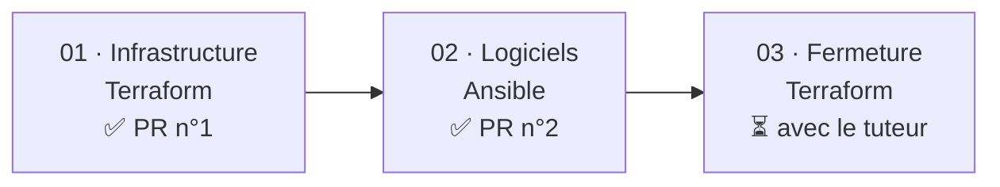
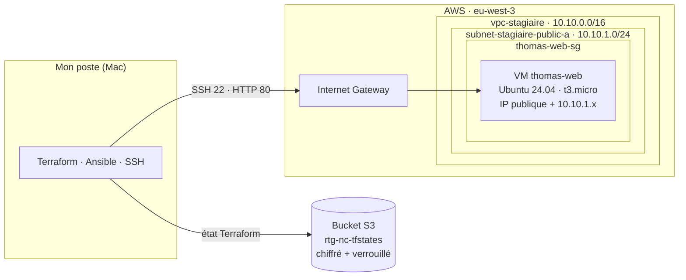
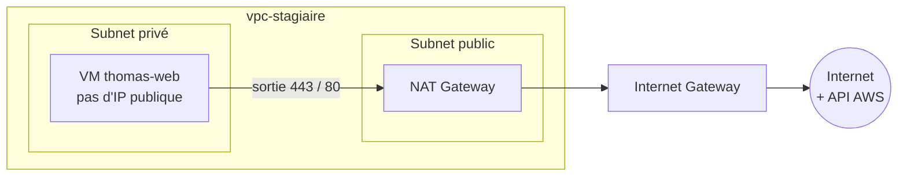
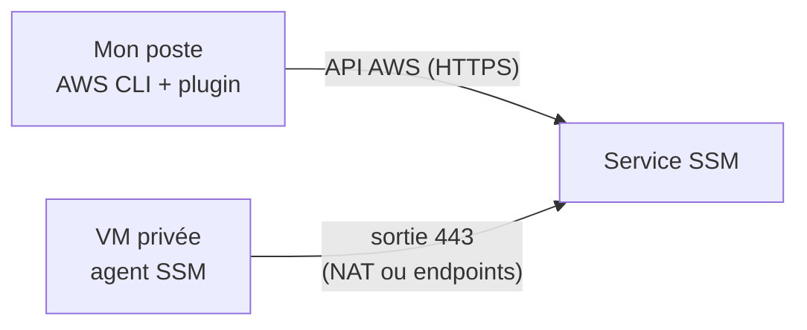
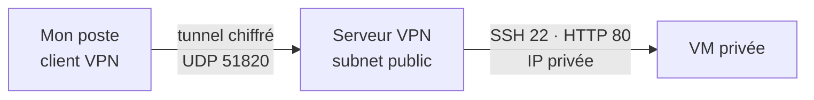

# Une VM web privée sur AWS, de Terraform à Ansible

> Alternance Retengr · Bachelor 3 Cybersécurité · Thomas Peyrusaubes
> Dépôt de code associé : `nc-private-vm-access`

Cette documentation retrace la construction d'une VM web sur AWS en *Infrastructure as Code*, puis sa sécurisation progressive jusqu'à ce qu'elle ne soit plus joignable depuis Internet. Elle compare enfin trois façons d'y accéder une fois fermée : **EICE**, **SSM Session Manager** et **VPN**.

## Sommaire

1. [Le besoin](#1-le-besoin)
2. [Point de départ : une première version trop complexe](#2-point-de-départ--une-première-version-trop-complexe)
3. [La démarche en trois temps](#3-la-démarche-en-trois-temps)
4. [Temps 1 · L'infrastructure avec Terraform](#4-temps-1--linfrastructure-avec-terraform)
5. [Temps 2 · La configuration avec Ansible](#5-temps-2--la-configuration-avec-ansible)
6. [Méthode de travail](#6-méthode-de-travail)
7. [Temps 3 · Fermer l'accès direct](#7-temps-3--fermer-laccès-direct)
8. [Accéder à une VM privée : EICE, SSM, VPN](#8-accéder-à-une-vm-privée--eice-ssm-vpn)
9. [Bilan](#9-bilan)
10. [Glossaire](#10-glossaire)

---

## 1. Le besoin

> « La VM ne doit jamais être joignable directement depuis Internet. La sortie vers Internet, elle, peut exister. »
> — Consigne du tuteur

| Élément | Choix |
|---|---|
| Région | `eu-west-3` (Paris) |
| Réseau | VPC partagé `vpc-stagiaire`, `10.10.0.0/16` |
| Serveur | Ubuntu 24.04, `t3.micro`, nginx |
| Accès final | VPN ou SSM, pas d'EICE |
| Méthode | Tout en code, tout relu en Pull Request |

---

## 2. Point de départ : une première version trop complexe

La première proposition (branche `ajout-vm-privee`) contenait : 2 subnets `/28`, une table de routage privée, un endpoint S3, un endpoint EICE, 3 security groups et une VM sans IP publique.

Elle était sécurisée, mais présentait trois limites :

| Limite | Explication |
|---|---|
| **CIDR écrits en dur** | Dans un VPC partagé, deux stagiaires qui créent le même subnet entrent en conflit. |
| **EICE** | Solution propriétaire AWS, refusée : l'accès doit passer par un VPN ou SSM (voir [§8](#8-accéder-à-une-vm-privée--eice-ssm-vpn)). |
| **Un subnet de trop** | Le subnet dédié à l'EICE n'était pas nécessaire. |

**Leçon** : partir simple, valider, puis sécuriser étape par étape.

---

## 3. La démarche en trois temps



| Temps | Outil | Objectif | Statut |
|---|---|---|---|
| 01 · Infrastructure | Terraform | Une VM qui démarre, accessible en SSH | Validé, PR n°1 |
| 02 · Logiciels | Ansible | nginx installé et une page personnalisée, sans toucher à l'infra | Validé, PR n°2 |
| 03 · Fermeture | Terraform | Plus d'IP publique, plus aucune règle entrante | À faire avec le tuteur |

---

## 4. Temps 1 · L'infrastructure avec Terraform

### 4.1 Architecture



### 4.2 Organisation du code

| Fichier | Rôle | Contenu clé |
|---|---|---|
| `versions.tf` | Outils et état | Terraform ≥ 1.10, provider AWS `~> 6.0`, backend S3, tag `rtg-project` |
| `variables.tf` | Réglages | `region`, `my_ip` (/32), `public_key_path`, `instance_type` |
| `main.tf` | Lire et créer | 2 data sources, key pair, security group, VM |
| `outputs.tf` | Affichage | `vm_public_ip` et la commande SSH prête à copier |

> 🔒 `terraform.tfvars` contient l'IP personnelle : il est ignoré par git, aucune donnée personnelle n'est publiée.

### 4.3 Lire l'existant, ne créer que le sien

- `data` **lit** une ressource existante, sans rien créer.
- `resource` **crée** une ressource.

```hcl
data "aws_subnet" "public_a" {
  filter {
    name   = "tag:Name"
    values = ["subnet-stagiaire-public-a"]
  }
}
```

Le subnet est retrouvé **par son nom**, et l'image Ubuntu par son propriétaire (Canonical) : aucun CIDR ni ID d'AMI n'est écrit en dur.

| Ressource créée | Rôle |
|---|---|
| `kp-thomas-web` | Clé SSH |
| `thomas-web-sg` | Pare-feu |
| `thomas-web` | La VM |

Chaque nom est préfixé par le prénom pour éviter les collisions dans le compte partagé.

### 4.4 Sécurité dès le premier jour

| Sens | Port | Source / destination | Pourquoi |
|---|---|---|---|
| Entrant | 22 (SSH) | `<mon_ip>/32` | Administrer la VM |
| Entrant | 80 (HTTP) | `<mon_ip>/32` | Tester le site |
| Sortant | tous | `0.0.0.0/0` | `apt`, mises à jour |

- **IMDSv2 obligatoire** : les métadonnées de la VM exigent un jeton, ce qui les rend beaucoup plus difficiles à voler via une faille web (type SSRF).
- **Disque chiffré** : volume `gp3` chiffré, illisible hors du compte.
- **IP publique provisoire** : acceptée au temps 1 pour tester, retirée au temps 3.

### 4.5 L'état Terraform, stocké dans S3


```hcl
backend "s3" {
  bucket       = "rtg-nc-tfstates"
  key          = "stagiaire/nc-private-vm-access/..."
  region       = "eu-west-3"
  use_lockfile = true # verrou pendant un apply
  encrypt      = true # état chiffré
}
```

> ⚠️ **Leçon retenue** : ne jamais lancer `terraform init -reconfigure` sur un backend modifié. Terraform repartirait d'un état vide et « oublierait » les ressources déjà créées.

---

## 5. Temps 2 · La configuration avec Ansible

### 5.1 Le playbook `site.yml`

| Tâche | Module | Effet |
|---|---|---|
| 1 | `apt` | Installer nginx (`update_cache`, `cache_valid_time: 3600`) |
| 2 | `service` | Démarrer et activer nginx (`state: started`, `enabled: true`) |
| 3 | `copy` | Personnaliser la page : « Bonjour, je suis Thomas Peyrusaubes » |

### 5.2 Adaptation d'Amazon Linux vers Ubuntu 24.04

| Élément | Amazon Linux | Ubuntu 24.04 |
|---|---|---|
| Utilisateur | `ec2-user` | `ubuntu` |
| Paquets | `dnf` | `apt` |
| Page par défaut | `/usr/share/nginx/html/index.html` | `/var/www/html/index.nginx-debian.html` |

### 5.3 Résultats : l'idempotence

| Exécution | Résultat | Signification |
|---|---|---|
| 1re | `changed=2` | nginx installé, page remplacée |
| 2e | `changed=0` | Tout est déjà en place, rien à refaire |
| Test | `200 OK` | `curl` : nginx/1.24.0 sert la page, vérifié par le tuteur |

**Idempotence** : on peut relancer le playbook sans risque, il ne fait que ce qui manque.

---

## 6. Méthode de travail


| Outil | Règle | Raison |
|---|---|---|
| **Terraform** | `apply` uniquement après revue et merge | Il crée des ressources payantes : une erreur peut coûter cher |
| **Ansible seul** | Test possible tout de suite, PR en parallèle | Il n'installe que des logiciels |

Messages de commit au format `type(scope): description`, en anglais. Exemple : `feat(ansible): install nginx`.

---

## 7. Temps 3 · Fermer l'accès direct

| Élément | Avant | Après |
|---|---|---|
| SSH (22) | mon IP | **fermé** |
| HTTP (80) | mon IP | **fermé** |
| IP publique | oui | **aucune** |
| Sortie Internet | ouverte | **à prévoir** (voir ci-dessous) |

Retirer l'IP publique oblige AWS à recréer la VM : le playbook Ansible la reconfigure.

### ⚠️ Point d'attention : la sortie Internet

Dans un subnet public, une VM sort vers Internet par l'Internet Gateway **uniquement si elle possède une IP publique**. Sans IP publique, elle perd **toute** sortie : plus d'`apt` et plus de SSM, car l'agent doit joindre AWS.

Pour respecter la consigne (« la sortie peut exister »), il faut ajouter l'une de ces deux solutions :

| Solution | Principe | Donne accès à | Coût indicatif |
|---|---|---|---|
| **NAT Gateway** | La VM, dans un subnet privé, sort par une NAT placée dans le subnet public | Internet + services AWS | ~0,05 $/h + données (~35 $/mois) |
| **VPC Endpoints** (interface) | Accès privé direct aux services AWS | Services AWS **uniquement** | ~0,01 $/h par endpoint et par AZ |



> 💡 À vérifier avec le tuteur : une NAT existe-t-elle déjà dans `vpc-stagiaire` ?

---

## 8. Accéder à une VM privée : EICE, SSM, VPN

Une fois la VM fermée, il faut un moyen d'entrer pour l'administrer. Trois approches existent, avec des philosophies différentes.

### 8.1 EICE · EC2 Instance Connect Endpoint

**Principe** : un endpoint géré par AWS, placé dans le VPC, ouvre un tunnel TCP entre le poste et le port 22 de la VM. L'authentification passe par IAM.


**Mise en œuvre**
- Ressource Terraform `aws_ec2_instance_connect_endpoint` dans un subnet.
- Le SG de la VM autorise le port 22 **depuis le SG de l'endpoint**.
- Connexion avec `aws ec2-instance-connect ssh --instance-id i-xxx`.

| ✅ Avantages | ❌ Limites |
|---|---|
| Gratuit | Propriétaire AWS, non transférable |
| Pas d'IP publique ni de bastion | Le port 22 reste ouvert sur la VM |
| Authentification IAM | Gestion de clés SSH toujours nécessaire |

**Pourquoi elle a été écartée** : EICE règle le problème « pas d'IP publique », mais pas celui de « aucun port entrant », et c'est une compétence spécifique à AWS.

### 8.2 SSM Session Manager

**Principe** : la logique est inversée. C'est la **VM qui appelle AWS** en sortie (HTTPS 443) et maintient un canal. L'utilisateur ouvre une session via l'API AWS. **Aucun port entrant n'est nécessaire, même pas le 22.**



**Prérequis**

| # | Élément | Détail |
|---|---|---|
| 1 | Agent SSM | Préinstallé sur les AMI Ubuntu 24.04 de Canonical (snap) |
| 2 | Rôle IAM | Instance profile avec `AmazonSSMManagedInstanceCore` |
| 3 | Sortie 443 | Vers `ssm`, `ssmmessages`, `ec2messages` (NAT ou 3 VPC endpoints) |
| 4 | Poste local | AWS CLI + `session-manager-plugin` |

**Ajouts Terraform**

```hcl
resource "aws_iam_role" "thomas_web_ssm" {
  name = "thomas-web-ssm"
  assume_role_policy = jsonencode({
    Version = "2012-10-17"
    Statement = [{
      Effect    = "Allow"
      Principal = { Service = "ec2.amazonaws.com" }
      Action    = "sts:AssumeRole"
    }]
  })
}

resource "aws_iam_role_policy_attachment" "ssm_core" {
  role       = aws_iam_role.thomas_web_ssm.name
  policy_arn = "arn:aws:iam::aws:policy/AmazonSSMManagedInstanceCore"
}

resource "aws_iam_instance_profile" "thomas_web" {
  name = "thomas-web-profile"
  role = aws_iam_role.thomas_web_ssm.name
}

# Sur la VM :
# iam_instance_profile = aws_iam_instance_profile.thomas_web.name
```

**Usages**

Ouvrir un shell :
```bash
aws ssm start-session --target i-xxxxxxxx
```

Tester nginx en redirigeant un port, puis ouvrir `http://localhost:8080` :
```bash
aws ssm start-session --target i-xxxxxxxx \
  --document-name AWS-StartPortForwardingSession \
  --parameters portNumber=80,localPortNumber=8080
```

Utiliser Ansible à travers SSM (`~/.ssh/config`) :
```
Host i-*
  User ubuntu
  ProxyCommand aws ssm start-session --target %h --document-name AWS-StartSSHSession --parameters portNumber=%p
```

| ✅ Avantages | ❌ Limites |
|---|---|
| **Zéro port entrant**, zéro exposition | Propriétaire AWS |
| Accès contrôlé et révocable par IAM | Dépend d'une sortie (NAT ou endpoints) |
| Sessions journalisables (CloudWatch, S3) | Plugin à installer sur le poste |
| Gratuit pour EC2 | |

### 8.3 VPN

**Principe** : un tunnel chiffré place le poste « dans » le VPC. La VM est ensuite jointe par son IP privée (`10.10.1.x`), comme sur un réseau local.



**Trois variantes**

| Variante | Fonctionnement | ✅ | ❌ |
|---|---|---|---|
| **AWS Client VPN** | Service managé (OpenVPN), auth par certificats ou SSO | Rien à maintenir | Cher : ~0,10 $/h par subnet associé + ~0,05 $/h par connexion (> 70 $/mois au repos) |
| **VPN auto-hébergé** (WireGuard, OpenVPN) | Petite EC2 dans le subnet public, 1 port UDP ouvert | Standard, portable, peu cher | Une machine exposée à patcher et surveiller |
| **Site-to-Site VPN** | Relie un réseau d'entreprise entier au VPC | Adapté à un bureau | Hors sujet pour un accès individuel |

**Impact sur la VM** : son SG autorise 22 et 80 **depuis le CIDR du VPN** (ou le SG du serveur VPN), et non plus depuis une IP publique.

| ✅ Avantages | ❌ Limites |
|---|---|
| Technologie standard, hors AWS | Un port reste exposé sur Internet |
| Accès réseau complet (tous les ports privés) | Un composant de plus à maintenir |
| Ansible fonctionne sans adaptation | Clés VPN + clés SSH à gérer |

### 8.4 Comparatif

| Critère | EICE | SSM | VPN (WireGuard) |
|---|---|---|---|
| Port entrant sur la VM | 22 (depuis l'endpoint) | **aucun** | 22/80 (depuis le VPN) |
| Port exposé sur Internet | aucun | **aucun** | 1 (UDP) |
| Authentification | IAM + clé SSH | **IAM** | Clés VPN + clé SSH |
| Journalisation native | CloudTrail | **CloudTrail + sessions** | À construire |
| Portabilité hors AWS | non | non | **oui** |
| Maintenance | nulle | faible | serveur à patcher |
| Ansible | oui | oui (ProxyCommand) | oui, direct |
| Coût | gratuit | gratuit (+ sortie) | ~1 petite EC2 |
| Conforme à la consigne | ❌ refusé | ✅ | ✅ |

### 8.5 Recommandation

**SSM Session Manager** répond le mieux à la consigne « jamais joignable depuis Internet » : rien n'est exposé, ni sur la VM ni ailleurs. Le **VPN** reste pertinent si l'objectif pédagogique est de maîtriser une brique réseau standard, indépendante d'AWS.

> Choix final : *à décider avec le tuteur.*

---

## 9. Bilan

### 9.1 Difficultés rencontrées

| Problème | Cause | Solution |
|---|---|---|
| IP affichée en IPv6 | Relais privé iCloud | `curl -4 api.ipify.org` |
| *Backend configuration changed* | Bloc backend incomplet | Recopier l'ancien bloc à l'identique |
| Security group refusé | Apostrophe dans la description | Description sans caractère spécial |
| Ansible : hôte injoignable | IP du poste au lieu de celle de la VM | IP lue dans `terraform output` |
| Ansible : erreur `dnf` | `main` encore en Amazon Linux | Version `apt`, PR n°2 fusionnée |
| Temps 3 appliqué trop tôt | `apply` sans revue | Plus d'`apply` Terraform avant merge |

### 9.2 Corrections demandées en revue (PR n°3)

- [x] **Tag `rtg-project`** : `default_tags` dans le provider, toutes les ressources sont identifiées
- [x] **`terraform fmt`** : indentation standard de `ingress`, `egress` et `tags`
- [x] **`inventory.ini.example`** : le vrai inventaire est ignoré par git ; l'exemple et le README expliquent comment le créer
- [x] **Preuves dans la PR** : `terraform plan` et les deux sorties `ansible-playbook` (`changed=0`)
- [x] **Messages de commit** : `type(scope): description`, en anglais

---

## 10. Glossaire

| Terme | Définition |
|---|---|
| **IaC** | *Infrastructure as Code* : décrire l'infrastructure dans des fichiers versionnés plutôt qu'à la main |
| **VPC** | Réseau privé virtuel isolé dans AWS |
| **Subnet** | Sous-réseau d'un VPC, rattaché à une zone de disponibilité |
| **Security Group** | Pare-feu à état attaché à une ressource (VM, endpoint…) |
| **Internet Gateway** | Porte d'entrée/sortie entre un VPC et Internet |
| **NAT Gateway** | Permet à des ressources privées de sortir vers Internet sans être joignables |
| **VPC Endpoint** | Accès privé à un service AWS sans passer par Internet |
| **IMDSv2** | Version sécurisée du service de métadonnées EC2, protégée par jeton |
| **Idempotence** | Propriété d'une opération qui produit le même résultat, qu'on l'exécute une ou plusieurs fois |
| **EICE** | EC2 Instance Connect Endpoint : tunnel SSH géré par AWS |
| **SSM** | AWS Systems Manager ; *Session Manager* en est le module d'accès sans port ouvert |
| **VPN** | Tunnel chiffré qui relie un poste ou un réseau à un réseau privé |
