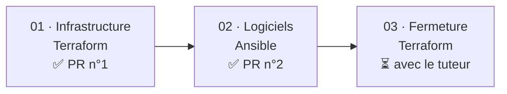
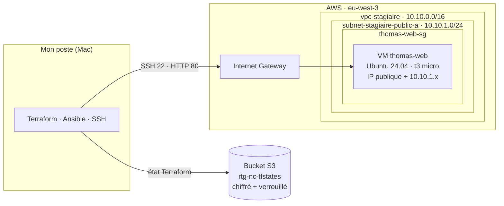
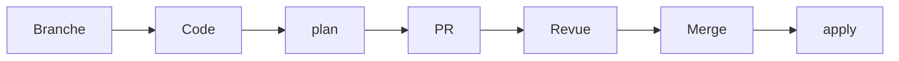
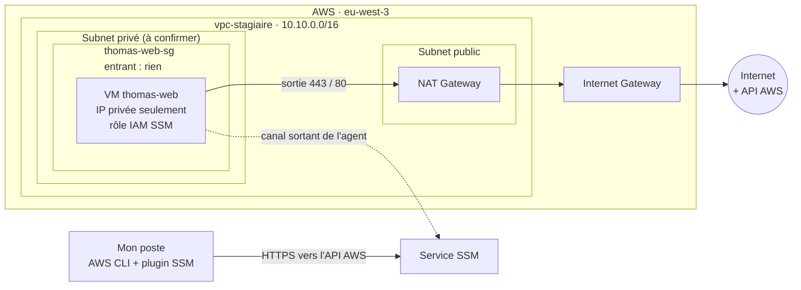
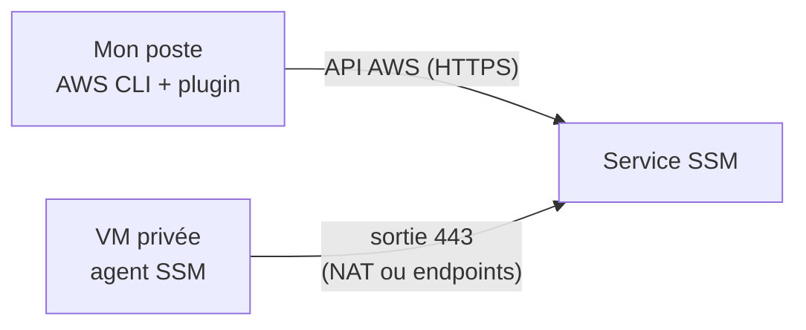
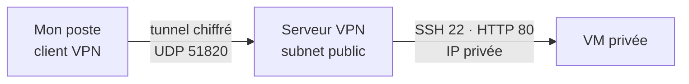

# Une VM web privée sur AWS, de Terraform à Ansible

> Alternance Retengr · Bachelor 3 Cybersécurité · Thomas Peyrusaubes
> Dépôt de code associé : `nc-private-vm-access`
> Dernière mise à jour : novembre 2026

Cette documentation retrace la construction d'une VM web sur AWS en *Infrastructure as Code*, puis sa sécurisation progressive jusqu'à ce qu'elle ne soit plus joignable depuis Internet. Elle compare ensuite trois façons d'y accéder une fois fermée (**EICE**, **SSM Session Manager**, **VPN**), propose le code du temps 3 et liste les points encore à décider avec le tuteur.

## État d'avancement

| Étape | Statut |
|---|---|
| Temps 1 · Infrastructure (Terraform) | ✅ Validé, PR n°1 |
| Temps 2 · Logiciels (Ansible) | ✅ Validé, PR n°2 |
| Corrections de revue | ✅ Validé, PR n°3 |
| Temps 3 · Fermeture | 📝 Code proposé dans ce document, **non appliqué** |
| Choix de l'accès (SSM ou VPN) | ❓ À décider avec le tuteur (voir [§10](#10-questions-ouvertes-pour-le-tuteur)) |

## Sommaire

1. [Le besoin](#1-le-besoin)
2. [Point de départ : une première version trop complexe](#2-point-de-départ--une-première-version-trop-complexe)
3. [La démarche en trois temps](#3-la-démarche-en-trois-temps)
4. [Temps 1 · L'infrastructure avec Terraform](#4-temps-1--linfrastructure-avec-terraform)
5. [Temps 2 · La configuration avec Ansible](#5-temps-2--la-configuration-avec-ansible)
6. [Méthode de travail](#6-méthode-de-travail)
7. [Temps 3 · Fermer l'accès direct](#7-temps-3--fermer-laccès-direct)
8. [Accéder à une VM privée : EICE, SSM, VPN](#8-accéder-à-une-vm-privée--eice-ssm-vpn)
9. [Durcissement complémentaire](#9-durcissement-complémentaire)
10. [Questions ouvertes pour le tuteur](#10-questions-ouvertes-pour-le-tuteur)
11. [Reproduire le projet](#11-reproduire-le-projet)
12. [Coûts et nettoyage](#12-coûts-et-nettoyage)
13. [Bilan](#13-bilan)
14. [Glossaire](#14-glossaire)
15. [Sources](#15-sources)

---

## 1. Le besoin

> « La VM ne doit jamais être joignable directement depuis Internet. La sortie vers Internet, elle, peut exister. »
> — Consigne du tuteur

| Élément | Choix |
|---|---|
| Région | `eu-west-3` (Paris) |
| Réseau | VPC partagé `vpc-stagiaire`, `10.10.0.0/16` |
| Serveur | Ubuntu 24.04, `t3.micro`, nginx |
| Accès final | VPN ou SSM, pas d'EICE |
| Méthode | Tout en code, tout relu en Pull Request |

La consigne contient **deux contraintes distinctes** qu'il ne faut pas confondre :

- **Entrée** : personne sur Internet ne doit pouvoir ouvrir une connexion vers la VM.
- **Sortie** : la VM, elle, doit pouvoir ouvrir des connexions vers Internet (mises à jour, services AWS).

---

## 2. Point de départ : une première version trop complexe

La première proposition (branche `ajout-vm-privee`) contenait : 2 subnets `/28`, une table de routage privée, un endpoint S3, un endpoint EICE, 3 security groups et une VM sans IP publique.

Elle était sécurisée, mais présentait trois limites :

| Limite | Explication |
|---|---|
| **CIDR écrits en dur** | Dans un VPC partagé, deux stagiaires qui créent le même subnet entrent en conflit. |
| **EICE** | Solution propriétaire AWS, refusée : l'accès doit passer par un VPN ou SSM (voir [§8](#8-accéder-à-une-vm-privée--eice-ssm-vpn)). |
| **Un subnet de trop** | Le subnet dédié à l'EICE n'était pas nécessaire. |

**Leçon** : partir simple, valider, puis sécuriser étape par étape.

---

## 3. La démarche en trois temps



| Temps | Outil | Objectif | Statut |
|---|---|---|---|
| 01 · Infrastructure | Terraform | Une VM qui démarre, accessible en SSH | Validé, PR n°1 |
| 02 · Logiciels | Ansible | nginx installé et une page personnalisée, sans toucher à l'infra | Validé, PR n°2 |
| 03 · Fermeture | Terraform | Plus d'IP publique, plus aucune règle entrante | À faire avec le tuteur |

---

## 4. Temps 1 · L'infrastructure avec Terraform

### 4.1 Architecture



### 4.2 Organisation du code

| Fichier | Rôle | Contenu clé |
|---|---|---|
| `versions.tf` | Outils et état | Terraform ≥ 1.10, provider AWS `~> 6.0`, backend S3, tag `rtg-project` |
| `variables.tf` | Réglages | `region`, `my_ip` (/32), `public_key_path`, `instance_type` |
| `main.tf` | Lire et créer | 2 data sources, key pair, security group, VM |
| `outputs.tf` | Affichage | `vm_public_ip` et la commande SSH prête à copier |

> 🔒 `terraform.tfvars` contient l'IP personnelle : il est ignoré par git, aucune donnée personnelle n'est publiée.

### 4.3 Lire l'existant, ne créer que le sien

- `data` **lit** une ressource existante, sans rien créer. Terraform ne la modifiera ni ne la détruira jamais.
- `resource` **crée** une ressource, dont Terraform devient responsable.

```hcl
data "aws_subnet" "public_a" {
  filter {
    name   = "tag:Name"
    values = ["subnet-stagiaire-public-a"]
  }
}
```

Le subnet est retrouvé **par son nom**, et l'image Ubuntu par son propriétaire (Canonical) : aucun CIDR ni ID d'AMI n'est écrit en dur.

| Ressource créée | Rôle |
|---|---|
| `kp-thomas-web` | Clé SSH |
| `thomas-web-sg` | Pare-feu |
| `thomas-web` | La VM |

Chaque nom est préfixé par le prénom pour éviter les collisions dans le compte partagé.

### 4.4 Sécurité dès le premier jour

| Sens | Port | Source / destination | Pourquoi |
|---|---|---|---|
| Entrant | 22 (SSH) | `<mon_ip>/32` | Administrer la VM |
| Entrant | 80 (HTTP) | `<mon_ip>/32` | Tester le site |
| Sortant | tous | `0.0.0.0/0` | `apt`, mises à jour |

- **IMDSv2 obligatoire** : le service de métadonnées de la VM (qui délivre notamment ses identifiants IAM temporaires) exige un jeton obtenu par une requête `PUT`. Une faille web de type SSRF, qui ne sait généralement faire que des `GET`, ne peut donc plus les voler.
- **Disque chiffré** : volume `gp3` chiffré, illisible hors du compte.
- **IP publique provisoire** : acceptée au temps 1 pour tester, retirée au temps 3.
- **Sortie large** : acceptée au temps 1, restreinte au temps 3 (voir [§7.4](#74-le-code-terraform-proposé)).

### 4.5 L'état Terraform, stocké dans S3

L'**état** (*state*) est la mémoire de Terraform : la liste des ressources qu'il a créées et leurs identifiants AWS. Sans lui, Terraform ne sait plus ce qui lui appartient.


```hcl
backend "s3" {
  bucket       = "rtg-nc-tfstates"
  key          = "stagiaire/nc-private-vm-access/..."
  region       = "eu-west-3"
  use_lockfile = true # verrou : deux apply simultanés sont impossibles
  encrypt      = true # état chiffré au repos
}
```

> ⚠️ **Leçon retenue** : ne jamais lancer `terraform init -reconfigure` sur un backend modifié. Cette option ignore l'ancien état au lieu de le migrer : Terraform repartirait d'un état vide, « oublierait » les ressources déjà créées et tenterait de les recréer en double.

---

## 5. Temps 2 · La configuration avec Ansible

### 5.1 Le playbook `site.yml`

| Tâche | Module | Effet |
|---|---|---|
| 1 | `apt` | Installer nginx (`update_cache`, `cache_valid_time: 3600`) |
| 2 | `service` | Démarrer et activer nginx (`state: started`, `enabled: true`) |
| 3 | `copy` | Personnaliser la page : « Bonjour, je suis Thomas Peyrusaubes » |

`cache_valid_time: 3600` évite de relancer `apt update` si le cache a moins d'une heure : le playbook reste rapide et idempotent.

### 5.2 Adaptation d'Amazon Linux vers Ubuntu 24.04

| Élément | Amazon Linux | Ubuntu 24.04 |
|---|---|---|
| Utilisateur | `ec2-user` | `ubuntu` |
| Paquets | `dnf` | `apt` |
| Page par défaut | `/usr/share/nginx/html/index.html` | `/var/www/html/index.nginx-debian.html` |

### 5.3 Résultats : l'idempotence

| Exécution | Résultat | Signification |
|---|---|---|
| 1re | `changed=2` | nginx installé, page remplacée |
| 2e | `changed=0` | Tout est déjà en place, rien à refaire |
| Test | `200 OK` | `curl` : nginx/1.24.0 sert la page, vérifié par le tuteur |

**Idempotence** : on peut relancer le playbook sans risque, il ne fait que ce qui manque.

---

## 6. Méthode de travail



| Outil | Règle | Raison |
|---|---|---|
| **Terraform** | `apply` uniquement après revue et merge | Il crée des ressources payantes : une erreur peut coûter cher |
| **Ansible seul** | Test possible tout de suite, PR en parallèle | Il n'installe que des logiciels |

Messages de commit au format `type(scope): description`, en anglais. Exemple : `feat(ansible): install nginx`.

---

## 7. Temps 3 · Fermer l'accès direct

### 7.1 Ce qui change

| Élément | Avant (temps 1) | Après (temps 3) |
|---|---|---|
| SSH (22) entrant | mon IP | **fermé** |
| HTTP (80) entrant | mon IP | **fermé** |
| IP publique | oui | **aucune** |
| Subnet | public | **privé** |
| Sortie | tous ports, via l'IGW | **443 et 80 uniquement, via une NAT** |
| Accès admin | SSH direct | **SSM** (ou VPN, à décider) |

Retirer l'IP publique et changer de subnet obligent AWS à **recréer la VM** : elle redémarre vierge, et le playbook Ansible la reconfigure (c'est tout l'intérêt de l'idempotence).

### 7.2 Le piège : la sortie Internet disparaît avec l'IP publique

Une **Internet Gateway** ne fait sortir une VM vers Internet que si celle-ci possède une **IP publique**. Sans IP publique, même dans un subnet public, et même avec une règle sortante ouverte dans le security group, **la VM n'a plus aucun chemin vers Internet**. Elle perd alors :

- `apt` et les mises à jour de sécurité ;
- l'accès aux API AWS, donc **SSM ne fonctionne plus** (l'agent doit joindre AWS en HTTPS).

> Le security group décide **si** un trafic est autorisé ; la table de routage décide **par où** il passe. Une règle sortante ouverte ne sert à rien s'il n'existe aucune route.

Deux solutions permettent de garder une sortie sans être joignable :

| Solution | Principe | Donne accès à | Coût indicatif (eu-west-3) |
|---|---|---|---|
| **NAT Gateway** | La VM est placée dans un subnet privé. Sa route `0.0.0.0/0` pointe vers une NAT, elle-même dans un subnet public. La NAT laisse sortir mais **refuse toute connexion initiée depuis l'extérieur**. | Internet + services AWS | ~0,05 $/h + ~0,05 $/Go traité, soit ~36 $/mois minimum |
| **VPC Endpoints** (interface) | Une interface réseau privée, dans le VPC, pour chaque service AWS utilisé. | Services AWS **uniquement** (pas d'`apt`) | ~0,01 $/h par endpoint et par AZ ; 3 pour SSM, soit ~24 $/mois |

**Choix retenu pour la suite : la NAT**, car c'est la seule qui respecte toute la consigne (`apt` doit pouvoir fonctionner). Les endpoints conviendraient à une VM qui n'a besoin que d'AWS.

### 7.3 Architecture cible



Lecture : **aucune flèche n'entre dans la VM**. Toutes les connexions partent d'elle, y compris le canal SSM par lequel je l'administre.

### 7.4 Le code Terraform proposé

> 📝 **Proposition, non appliquée.** Elle dépend des réponses du tuteur ([§10](#10-questions-ouvertes-pour-le-tuteur)), notamment du nom du subnet privé. Elle suivra le circuit habituel : branche, `plan`, PR, revue, merge, `apply`.

**`variables.tf`** : le subnet privé est lu par son nom, comme au temps 1.

```hcl
variable "private_subnet_name" {
  description = "Name tag of the existing private subnet"
  type        = string
  default     = "subnet-stagiaire-private-a" # nom à confirmer avec le tuteur
}
```

`my_ip` n'est plus utile : plus aucune règle ne dépend de mon IP.

**`main.tf`** : lecture du subnet privé.

```hcl
data "aws_subnet" "private_a" {
  filter {
    name   = "tag:Name"
    values = [var.private_subnet_name]
  }
}
```

**`main.tf`** : security group sans aucune règle entrante, sortie restreinte.

```hcl
resource "aws_security_group" "web" {
  name        = "thomas-web-sg"
  description = "Thomas web VM no inbound" # sans apostrophe (voir Bilan)
  vpc_id      = data.aws_subnet.private_a.vpc_id

  # Aucun bloc ingress : rien ne peut entrer.

  egress {
    description = "HTTPS for SSM agent and AWS APIs"
    from_port   = 443
    to_port     = 443
    protocol    = "tcp"
    cidr_blocks = ["0.0.0.0/0"]
  }

  egress {
    description = "HTTP for apt repositories"
    from_port   = 80
    to_port     = 80
    protocol    = "tcp"
    cidr_blocks = ["0.0.0.0/0"]
  }
}
```

Pourquoi 443 et 80 seulement :

| Port | Utilisé par |
|---|---|
| 443 (HTTPS) | Agent SSM, API AWS |
| 80 (HTTP) | Dépôts `apt` d'Ubuntu (les paquets sont signés, le HTTP n'est pas un risque d'intégrité) |
| DNS, NTP | **Rien à ouvrir** : le trafic vers le résolveur DNS d'AWS et son service NTP (`169.254.169.123`) n'est pas filtré par les security groups |

> ℹ️ Modifier la `description` d'un security group force Terraform à le **détruire et le recréer**. Ici ce n'est pas gênant puisque la VM est recréée de toute façon.

**`iam.tf`** (nouveau fichier) : le rôle qui permet à l'agent SSM de s'enregistrer.

```hcl
# Qui peut endosser ce rôle : le service EC2, pour le compte de la VM.
resource "aws_iam_role" "thomas_web_ssm" {
  name = "thomas-web-ssm"
  assume_role_policy = jsonencode({
    Version = "2012-10-17"
    Statement = [{
      Effect    = "Allow"
      Principal = { Service = "ec2.amazonaws.com" }
      Action    = "sts:AssumeRole"
    }]
  })
}

# Ce que le rôle permet : le strict minimum géré par AWS pour SSM.
resource "aws_iam_role_policy_attachment" "ssm_core" {
  role       = aws_iam_role.thomas_web_ssm.name
  policy_arn = "arn:aws:iam::aws:policy/AmazonSSMManagedInstanceCore"
}

# L'enveloppe qui permet d'attacher le rôle à une VM.
resource "aws_iam_instance_profile" "thomas_web" {
  name = "thomas-web-profile"
  role = aws_iam_role.thomas_web_ssm.name
}
```

Un rôle IAM ne s'attache pas directement à une VM : il passe par un **instance profile**. Les identifiants du rôle sont alors fournis à la VM par le service de métadonnées, protégé par IMDSv2.

**`main.tf`** : la VM.

```hcl
resource "aws_instance" "web" {
  # ... ami, instance_type, key_name, IMDSv2, disque chiffré : inchangés

  subnet_id                   = data.aws_subnet.private_a.id
  associate_public_ip_address = false
  vpc_security_group_ids      = [aws_security_group.web.id]
  iam_instance_profile        = aws_iam_instance_profile.thomas_web.name
}
```

La clé SSH (`kp-thomas-web`) est **conservée** : Ansible continue de se connecter en SSH, mais à travers le tunnel SSM ([§8.2](#82-ssm-session-manager)).

**`outputs.tf`** : l'IP publique n'existe plus, on affiche ce qui sert à se connecter.

```hcl
output "vm_instance_id" {
  value = aws_instance.web.id
}

output "vm_private_ip" {
  value = aws_instance.web.private_ip
}

output "ssm_command" {
  value = "aws ssm start-session --target ${aws_instance.web.id} --region ${var.region}"
}
```

**Ce que le `terraform plan` doit montrer** (à joindre à la PR) :

| Ressource | Action attendue |
|---|---|
| `aws_iam_role`, `aws_iam_role_policy_attachment`, `aws_iam_instance_profile` | `+ create` |
| `aws_security_group.web` | `-/+ replace` (description modifiée) |
| `aws_instance.web` | `-/+ replace` (subnet et IP publique modifiés) |
| `data.aws_subnet.*` | lecture seule, jamais modifiés |

Si le plan annonce la modification ou la destruction d'une ressource qui n'est pas préfixée `thomas-`, **on s'arrête** : c'est le signe d'une erreur.

### 7.5 Prouver que la VM est fermée

Ces vérifications sont à exécuter après l'`apply` et à joindre à la PR, au même titre que le `changed=0` du temps 2.

**1. La VM n'a pas d'IP publique.**

```bash
aws ec2 describe-instances --instance-ids <instance_id> \
  --query "Reservations[].Instances[].PublicIpAddress" --output text
```

Résultat attendu : **vide**.

**2. Le security group n'a aucune règle entrante.**

```bash
aws ec2 describe-security-groups --filters Name=group-name,Values=thomas-web-sg \
  --query "SecurityGroups[].IpPermissions"
```

Résultat attendu : `[ [] ]`.

**3. Le subnet n'a aucune route directe vers l'Internet Gateway.**

```bash
aws ec2 describe-route-tables \
  --filters Name=association.subnet-id,Values=<subnet_id> \
  --query "RouteTables[].Routes[]"
```

Résultat attendu : la route `0.0.0.0/0` pointe vers un `nat-…`, **jamais vers un `igw-…`**. Une route vers l'IGW dans un subnet « privé » le rendrait public.

**4. L'accès d'administration fonctionne.**

```bash
aws ssm start-session --target <instance_id>
```

Résultat attendu : un shell `ssm-user` s'ouvre sur la VM.

**5. La sortie fonctionne, depuis la session SSM.**

```bash
curl -sI https://archive.ubuntu.com | head -1
```

Résultat attendu : une réponse HTTP (`HTTP/1.1 200` ou une redirection). La VM sort bien par la NAT.

**6. Le site répond, sans être exposé** (redirection de port via SSM, depuis mon poste) :

```bash
aws ssm start-session --target <instance_id> \
  --document-name AWS-StartPortForwardingSession \
  --parameters portNumber=80,localPortNumber=8080
# puis, dans un autre terminal :
curl -s http://localhost:8080 | grep Thomas
```

Résultat attendu : la page « Bonjour, je suis Thomas Peyrusaubes ».

Les points 1 à 3 prouvent que **rien ne peut entrer** ; les points 4 à 6 prouvent que **tout fonctionne quand même**.

---

## 8. Accéder à une VM privée : EICE, SSM, VPN

Une fois la VM fermée, il faut un moyen d'entrer pour l'administrer. Trois approches existent, avec des philosophies différentes.

### 8.1 EICE · EC2 Instance Connect Endpoint

**Principe** : un endpoint géré par AWS, placé dans le VPC, ouvre un tunnel TCP entre le poste et le port 22 de la VM. L'authentification passe par IAM (action `ec2-instance-connect:OpenTunnel`).


**Mise en œuvre**
- Ressource Terraform `aws_ec2_instance_connect_endpoint` dans un subnet.
- Le SG de la VM autorise le port 22 **depuis le SG de l'endpoint**.
- Connexion avec `aws ec2-instance-connect ssh --instance-id i-xxx`.

| ✅ Avantages | ❌ Limites |
|---|---|
| Gratuit | Propriétaire AWS, non transférable |
| Pas d'IP publique ni de bastion | Le port 22 reste ouvert sur la VM |
| Authentification IAM | Gestion de clés SSH toujours nécessaire |

**Pourquoi elle a été écartée** : EICE règle le problème « pas d'IP publique », mais pas celui de « aucun port entrant », et c'est une compétence spécifique à AWS.

### 8.2 SSM Session Manager

**Principe** : la logique est inversée. Au démarrage, l'**agent SSM** installé sur la VM ouvre une connexion sortante HTTPS vers le service SSM et la maintient. Quand je lance une session, AWS la fait passer par ce canal déjà ouvert. **La VM n'accepte jamais de connexion entrante, pas même sur le port 22.**



**Prérequis**

| # | Élément | Détail | Si absent |
|---|---|---|---|
| 1 | Agent SSM | Préinstallé sur les AMI Ubuntu 24.04 de Canonical (paquet snap `amazon-ssm-agent`) | À installer via Ansible |
| 2 | Rôle IAM | Instance profile avec `AmazonSSMManagedInstanceCore` ([§7.4](#74-le-code-terraform-proposé)) | La VM n'apparaît pas dans SSM |
| 3 | Sortie 443 | Vers `ssm`, `ssmmessages`, `ec2messages` (NAT ou 3 VPC endpoints) | La VM apparaît « hors ligne » |
| 4 | Poste local | AWS CLI v2 + `session-manager-plugin` | Erreur « SessionManagerPlugin is not found » |

Vérifier que la VM est bien enregistrée :

```bash
aws ssm describe-instance-information \
  --query "InstanceInformationList[].{id:InstanceId,ping:PingStatus}"
```

Résultat attendu : `"ping": "Online"` pour l'ID de la VM.

**Usages**

Ouvrir un shell :
```bash
aws ssm start-session --target i-xxxxxxxx
```

Tester nginx en redirigeant un port, puis ouvrir `http://localhost:8080` :
```bash
aws ssm start-session --target i-xxxxxxxx \
  --document-name AWS-StartPortForwardingSession \
  --parameters portNumber=80,localPortNumber=8080
```

**Faire passer Ansible par SSM**

Ansible parle SSH. Le document `AWS-StartSSHSession` transporte une connexion SSH normale à l'intérieur du canal SSM : la clé SSH reste nécessaire, mais le port 22 n'est jamais exposé.

Dans `~/.ssh/config` :

```
# Toute cible dont le nom commence par "i-" passe par SSM
Host i-*
  User ubuntu
  IdentityFile ~/.ssh/thomas-web
  ProxyCommand sh -c "aws ssm start-session --target %h --document-name AWS-StartSSHSession --parameters 'portNumber=%p' --region eu-west-3"
```

Dans `inventory.ini` (ignoré par git), l'hôte devient l'ID de la VM au lieu de son IP :

```ini
[web]
i-0123456789abcdef0 ansible_user=ubuntu
```

Le playbook lui-même ne change pas.

| ✅ Avantages | ❌ Limites |
|---|---|
| **Zéro port entrant**, zéro exposition | Propriétaire AWS |
| Accès contrôlé et révocable par IAM | Dépend d'une sortie (NAT ou endpoints) |
| Sessions journalisables (CloudWatch, S3) | Plugin à installer sur le poste |
| Gratuit pour EC2 | |

### 8.3 VPN

**Principe** : un tunnel chiffré place le poste « dans » le VPC. La VM est ensuite jointe par son IP privée (`10.10.x.x`), comme sur un réseau local.



**Trois variantes**

| Variante | Fonctionnement | ✅ | ❌ |
|---|---|---|---|
| **AWS Client VPN** | Service managé (OpenVPN), auth par certificats ou SSO | Rien à maintenir | Cher : ~0,10 $/h par subnet associé + ~0,05 $/h par connexion (> 70 $/mois au repos) |
| **VPN auto-hébergé** (WireGuard, OpenVPN) | Petite EC2 dans le subnet public, 1 port UDP ouvert | Standard, portable, peu cher | Une machine exposée à patcher et surveiller |
| **Site-to-Site VPN** | Relie un réseau d'entreprise entier au VPC | Adapté à un bureau | Hors sujet pour un accès individuel |

**Impact sur la VM** : son SG autorise 22 et 80 **uniquement depuis le SG du serveur VPN**, et non plus depuis une IP publique.

| ✅ Avantages | ❌ Limites |
|---|---|
| Technologie standard, hors AWS | Un port reste exposé sur Internet |
| Accès réseau complet (tous les ports privés) | Un composant de plus à maintenir |
| Ansible fonctionne sans adaptation | Clés VPN + clés SSH à gérer |

### 8.4 Comparatif

| Critère | EICE | SSM | VPN (WireGuard) |
|---|---|---|---|
| Port entrant sur la VM | 22 (depuis l'endpoint) | **aucun** | 22/80 (depuis le VPN) |
| Port exposé sur Internet | aucun | **aucun** | 1 (UDP) |
| Authentification | IAM + clé SSH | **IAM** | Clés VPN + clé SSH |
| Journalisation native | CloudTrail | **CloudTrail + sessions** | À construire |
| Portabilité hors AWS | non | non | **oui** |
| Maintenance | nulle | faible | serveur à patcher |
| Ansible | oui | oui (ProxyCommand) | oui, direct |
| Coût | gratuit | gratuit (+ sortie) | ~1 petite EC2 |
| Conforme à la consigne | ❌ refusé | ✅ | ✅ |

### 8.5 Recommandation

**SSM Session Manager** répond le mieux à la consigne « jamais joignable depuis Internet » : rien n'est exposé, ni sur la VM ni ailleurs. Le **VPN** reste pertinent si l'objectif pédagogique est de maîtriser une brique réseau standard, indépendante d'AWS.

> Choix final : *à décider avec le tuteur.*

---

## 9. Durcissement complémentaire

Fermer les ports est la mesure principale. Les mesures suivantes ajoutent des couches de défense (*défense en profondeur*) : si l'une cède, les autres limitent les dégâts.

### 9.1 Sortie restreinte

**Problème** : au temps 1, la VM peut sortir vers n'importe quelle destination sur n'importe quel port. Si elle était compromise, un attaquant pourrait l'utiliser librement : exfiltrer des données, contacter un serveur de commande, scanner d'autres machines.

**Mesure** : n'autoriser que 443 et 80 en sortie ([§7.4](#74-le-code-terraform-proposé)).

**Limite assumée** : 443 reste ouvert vers tout Internet, car les IP des services AWS et des dépôts Ubuntu changent. Restreindre par nom de domaine nécessiterait un pare-feu applicatif (AWS Network Firewall), disproportionné pour ce projet.

### 9.2 Moindre privilège pour les utilisateurs

**Problème** : avec SSM, **IAM devient la porte d'entrée**. Toute personne du compte ayant le droit `ssm:StartSession` sur `*` peut ouvrir un shell sur **toutes** les VM, y compris celles des autres stagiaires.

**Mesure** : une politique qui n'autorise la session que sur les VM portant mon tag, et uniquement avec les documents nécessaires.

```json
{
  "Version": "2012-10-17",
  "Statement": [
    {
      "Sid": "SessionOnlyOnThomasWeb",
      "Effect": "Allow",
      "Action": "ssm:StartSession",
      "Resource": "arn:aws:ec2:eu-west-3:<ACCOUNT_ID>:instance/*",
      "Condition": {
        "StringEquals": { "ssm:resourceTag/Name": "thomas-web" }
      }
    },
    {
      "Sid": "AllowedSessionDocuments",
      "Effect": "Allow",
      "Action": "ssm:StartSession",
      "Resource": [
        "arn:aws:ssm:eu-west-3:<ACCOUNT_ID>:document/SSM-SessionManagerRunShell",
        "arn:aws:ssm:eu-west-3::document/AWS-StartSSHSession",
        "arn:aws:ssm:eu-west-3::document/AWS-StartPortForwardingSession"
      ]
    },
    {
      "Sid": "ManageOnlyMyOwnSessions",
      "Effect": "Allow",
      "Action": ["ssm:TerminateSession", "ssm:ResumeSession"],
      "Resource": "arn:aws:ssm:*:*:session/${aws:userid}-*"
    }
  ]
}
```

Lecture bloc par bloc :

| Bloc | Effet |
|---|---|
| `SessionOnlyOnThomasWeb` | Une session ne peut viser qu'une VM dont le tag `Name` vaut `thomas-web`. |
| `AllowedSessionDocuments` | Seuls trois types de session sont permis : shell, SSH tunnelé, redirection de port. |
| `ManageOnlyMyOwnSessions` | Je ne peux fermer ou reprendre que **mes** sessions, pas celles des autres. |

> ⚠️ Les droits des utilisateurs du compte sont gérés par l'administrateur, pas par mon code. Cette politique est une **proposition à soumettre au tuteur**. Si elle est écrite dans un fichier Terraform, `${aws:userid}` doit être échappé en `$${aws:userid}`, sinon Terraform tente de l'interpréter.

**Limite** : le tag `Name` est modifiable par quiconque a les droits `ec2:CreateTags`. Dans un vrai environnement, on protège aussi ce droit.

### 9.3 Journalisation des sessions

**Problème** : par défaut, CloudTrail enregistre **qu'une session a été ouverte**, par qui et quand, mais **pas ce qui y a été tapé**.

**Mesure** : SSM peut enregistrer le contenu complet de chaque session dans un groupe CloudWatch Logs ou un bucket S3. Il faut alors :

1. créer la destination (groupe de logs ou bucket) ;
2. ajouter au rôle de la VM le droit d'y écrire (`logs:CreateLogStream`, `logs:PutLogEvents`, ou `s3:PutObject`) ;
3. déclarer la destination dans les **préférences de Session Manager** (document `SSM-SessionManagerRunShell`).

> ⚠️ **Point bloquant dans un compte partagé** : les préférences de Session Manager sont **uniques pour tout le compte et toute la région**. Si je les modifie, je change la journalisation de tous les stagiaires. C'est donc au tuteur ou à l'administrateur de les configurer ([§10](#10-questions-ouvertes-pour-le-tuteur)).

**Limite** : la journalisation ne capte pas le contenu des sessions `AWS-StartSSHSession` et `AWS-StartPortForwardingSession`, qui sont chiffrées de bout en bout par SSH ou transportent un flux brut. Seul leur démarrage est tracé.

### 9.4 Mises à jour de sécurité automatiques

**Problème** : une VM fermée, à laquelle personne ne se connecte, n'est jamais mise à jour à la main. Les failles s'accumulent.

**Mesure** : `unattended-upgrades` installe automatiquement les correctifs de sécurité Ubuntu. Il est présent par défaut sur Ubuntu 24.04 ; deux tâches Ansible **garantissent** qu'il est installé et activé, même si l'image change.

```yaml
- name: Ensure unattended-upgrades is installed
  ansible.builtin.apt:
    name: unattended-upgrades
    state: present

- name: Enable daily security updates
  ansible.builtin.copy:
    dest: /etc/apt/apt.conf.d/20auto-upgrades
    content: |
      APT::Periodic::Update-Package-Lists "1";
      APT::Periodic::Unattended-Upgrade "1";
    mode: "0644"
```

Ces mises à jour passent par la NAT, sur le port 80 ou 443 : c'est l'une des raisons pour lesquelles la sortie doit exister.

---

## 10. Questions ouvertes pour le tuteur

| # | Question | Pourquoi elle bloque | Options |
|---|---|---|---|
| 1 | **SSM ou VPN ?** | Détermine le code du temps 3 et le mode de connexion d'Ansible. | Recommandation : SSM ([§8.5](#85-recommandation)). |
| 2 | **Existe-t-il un subnet privé dans `vpc-stagiaire` ? Quel est son nom ?** | La VM doit y aller pour sortir par une NAT. Or la règle du projet est de **lire** l'existant, pas de créer des subnets avec des CIDR en dur (limite n°1 de la première version). | a) Un subnet privé existe : je le lis par son tag. b) Il n'existe pas : le tuteur le crée, ou m'attribue un CIDR réservé. |
| 3 | **Existe-t-il une NAT Gateway partagée ?** | Une NAT coûte ~36 $/mois. En créer une par stagiaire serait du gaspillage. | a) Une NAT partagée existe, le subnet privé y est déjà routé. b) Sinon, VPC endpoints (mais `apt` ne fonctionnera plus). |
| 4 | **Le site doit-il être visible un jour ?** | Une fois fermé, la page nginx n'est visible que par moi, via la redirection de port SSM. | a) Non : c'est un serveur interne, la configuration est finale. b) Oui : il faut un **Application Load Balancer** dans le subnet public, seul exposé, qui transmet le trafic à la VM. C'est une étape supplémentaire. |
| 5 | **Qui configure la journalisation SSM et les droits des utilisateurs ?** | Ce sont des réglages à l'échelle du compte ([§9.2](#92-moindre-privilège-pour-les-utilisateurs), [§9.3](#93-journalisation-des-sessions)). | Administrateur du compte, sur proposition. |

---

## 11. Reproduire le projet

### 11.1 Prérequis sur le poste

| Outil | Version | Vérification |
|---|---|---|
| AWS CLI | v2 | `aws --version` |
| Accès au compte | profil configuré | `aws sts get-caller-identity` |
| Terraform | ≥ 1.10 | `terraform version` |
| Ansible | récent | `ansible --version` |
| Session Manager plugin | (temps 3) | `session-manager-plugin --version` |
| Clé SSH | ed25519 | `ls ~/.ssh/thomas-web.pub` |

Créer la clé si elle n'existe pas :

```bash
ssh-keygen -t ed25519 -f ~/.ssh/thomas-web -C "thomas-web"
```

### 11.2 Temps 1 · Créer la VM

```bash
git clone <url-du-depot>/nc-private-vm-access.git
cd nc-private-vm-access/terraform

# 1. Récupérer son IP publique en IPv4 (pas d'IPv6, voir Bilan)
curl -4 api.ipify.org

# 2. Créer terraform.tfvars (ignoré par git)
cat > terraform.tfvars <<EOF
my_ip           = "<mon_ip>/32"
public_key_path = "~/.ssh/thomas-web.pub"
EOF

# 3. Initialiser le backend S3, puis planifier
terraform init
terraform fmt -check
terraform validate
terraform plan

# 4. Appliquer, uniquement après revue et merge de la PR
terraform apply

# 5. Lire l'IP de la VM
terraform output
```

### 11.3 Temps 2 · Configurer la VM

```bash
cd ../ansible
cp inventory.ini.example inventory.ini
# Remplacer l'IP par celle donnée par "terraform output"

ansible-playbook -i inventory.ini site.yml   # attendu : changed=2
ansible-playbook -i inventory.ini site.yml   # attendu : changed=0
curl -I http://<ip_de_la_vm>                 # attendu : 200 OK
```

### 11.4 Temps 3 · Fermer

Après validation des questions du [§10](#10-questions-ouvertes-pour-le-tuteur) :

1. appliquer le code du [§7.4](#74-le-code-terraform-proposé) (branche, `plan`, PR, revue, merge, `apply`) ;
2. configurer `~/.ssh/config` et `inventory.ini` pour passer par SSM ([§8.2](#82-ssm-session-manager)) ;
3. relancer le playbook, car la VM recréée est vierge (`changed` > 0, puis `changed=0`) ;
4. exécuter les six vérifications du [§7.5](#75-prouver-que-la-vm-est-fermée) et les joindre à la PR.

---

## 12. Coûts et nettoyage

### 12.1 Coûts mensuels estimés

> Ordres de grandeur pour `eu-west-3`, relevés en novembre 2026, hors offre gratuite. À vérifier sur les pages de tarifs ([§15](#15-sources)) avant toute décision.

| Ressource | Coût indicatif | Remarque |
|---|---|---|
| VM `t3.micro` allumée en continu | ~9 $/mois | Arrêter la VM quand elle ne sert pas |
| Disque `gp3` 8 Go | ~1 $/mois | Facturé même VM arrêtée |
| NAT Gateway | ~36 $/mois + données | Le poste le plus cher : à **partager** entre stagiaires |
| 3 VPC endpoints (alternative) | ~24 $/mois | Par AZ |
| SSM Session Manager | gratuit | |
| Bucket S3 de l'état | quelques centimes | Partagé |
| **Total, NAT partagée** | **~10 $/mois** | |
| **Total, NAT dédiée** | **~46 $/mois** | |

### 12.2 Tout supprimer proprement

Quand le projet est terminé, ou pour repartir de zéro :

```bash
cd terraform
terraform plan -destroy   # lire la liste AVANT de détruire
terraform destroy
```

Ce que `destroy` supprime : **uniquement** les ressources déclarées en `resource` (clé, security group, VM, rôle IAM). Les éléments lus en `data` (VPC, subnets, NAT partagée) **ne sont jamais touchés** : c'est une autre garantie du principe « lire l'existant, ne créer que le sien ».

Vérification avant de valider : chaque ressource listée par `plan -destroy` doit être préfixée `thomas-` ou `kp-thomas-`. Si une autre apparaît, **on annule**.

Après la destruction, l'état reste dans S3 mais ne contient plus aucune ressource. Il peut être conservé pour un futur `apply`.

---

## 13. Bilan

### 13.1 Difficultés rencontrées

| Problème | Cause | Solution |
|---|---|---|
| IP affichée en IPv6 | Relais privé iCloud | `curl -4 api.ipify.org` |
| *Backend configuration changed* | Bloc backend incomplet | Recopier l'ancien bloc à l'identique |
| Security group refusé | Apostrophe dans la description | Description sans caractère spécial |
| Ansible : hôte injoignable | IP du poste au lieu de celle de la VM | IP lue dans `terraform output` |
| Ansible : erreur `dnf` | `main` encore en Amazon Linux | Version `apt`, PR n°2 fusionnée |
| Temps 3 appliqué trop tôt | `apply` sans revue | Plus d'`apply` Terraform avant merge |

### 13.2 Corrections demandées en revue (PR n°3)

- [x] **Tag `rtg-project`** : `default_tags` dans le provider, toutes les ressources sont identifiées
- [x] **`terraform fmt`** : indentation standard de `ingress`, `egress` et `tags`
- [x] **`inventory.ini.example`** : le vrai inventaire est ignoré par git ; l'exemple et le README expliquent comment le créer
- [x] **Preuves dans la PR** : `terraform plan` et les deux sorties `ansible-playbook` (`changed=0`)
- [x] **Messages de commit** : `type(scope): description`, en anglais

### 13.3 Ce que je retiens

- **Sécuriser par étapes** : une version simple qui fonctionne, puis une fermeture progressive, se relit et se corrige bien mieux qu'une architecture complète d'emblée.
- **Routage et filtrage sont deux choses différentes** : une règle de pare-feu ouverte ne crée pas de chemin réseau ([§7.2](#72-le-piège--la-sortie-internet-disparaît-avec-lip-publique)).
- **Fermer les ports déplace la porte d'entrée vers IAM** : avec SSM, la sécurité de la VM dépend des droits des utilisateurs ([§9.2](#92-moindre-privilège-pour-les-utilisateurs)).
- **Prouver, pas affirmer** : chaque étape se termine par des sorties de commandes jointes à la PR.

---

## 14. Glossaire

| Terme | Définition |
|---|---|
| **ALB** | *Application Load Balancer* : répartiteur de charge HTTP d'AWS, placé dans un subnet public, qui permet d'exposer un site sans exposer la VM elle-même |
| **Bastion** | VM exposée servant uniquement de point de passage vers des machines privées |
| **Défense en profondeur** | Empiler plusieurs mesures de sécurité indépendantes, pour qu'une seule défaillance ne suffise pas |
| **EICE** | EC2 Instance Connect Endpoint : tunnel SSH géré par AWS |
| **IaC** | *Infrastructure as Code* : décrire l'infrastructure dans des fichiers versionnés plutôt qu'à la main |
| **Idempotence** | Propriété d'une opération qui produit le même résultat, qu'on l'exécute une ou plusieurs fois |
| **IMDSv2** | Version sécurisée du service de métadonnées EC2, protégée par jeton |
| **Instance profile** | Conteneur qui permet d'attacher un rôle IAM à une VM |
| **Internet Gateway** | Porte d'entrée et de sortie entre un VPC et Internet, utilisable seulement par les ressources ayant une IP publique |
| **Moindre privilège** | N'accorder que les droits strictement nécessaires à une tâche |
| **NAT Gateway** | Permet à des ressources privées de sortir vers Internet sans être joignables |
| **Rôle IAM** | Identité AWS sans mot de passe, endossée temporairement par un service ou une VM |
| **Security Group** | Pare-feu à état attaché à une ressource : une réponse à une connexion autorisée est automatiquement autorisée |
| **SSM** | AWS Systems Manager ; *Session Manager* en est le module d'accès sans port ouvert |
| **SSRF** | *Server-Side Request Forgery* : faille qui pousse un serveur à envoyer des requêtes à la place de l'attaquant |
| **Subnet privé** | Subnet dont la table de routage n'a pas de route vers l'Internet Gateway |
| **Subnet public** | Subnet dont la table de routage a une route `0.0.0.0/0` vers l'Internet Gateway |
| **VPC** | Réseau privé virtuel isolé dans AWS |
| **VPC Endpoint** | Accès privé à un service AWS sans passer par Internet |
| **VPN** | Tunnel chiffré qui relie un poste ou un réseau à un réseau privé |

---

## 15. Sources

Documentation AWS :

- [AWS Systems Manager Session Manager](https://docs.aws.amazon.com/systems-manager/latest/userguide/session-manager.html)
- [Session Manager : prérequis](https://docs.aws.amazon.com/systems-manager/latest/userguide/session-manager-prerequisites.html)
- [EC2 Instance Connect Endpoint](https://docs.aws.amazon.com/AWSEC2/latest/UserGuide/connect-with-ec2-instance-connect-endpoint.html)
- [NAT Gateways](https://docs.aws.amazon.com/vpc/latest/userguide/vpc-nat-gateway.html)
- [Instance Metadata Service (IMDSv2)](https://docs.aws.amazon.com/AWSEC2/latest/UserGuide/configuring-instance-metadata-service.html)
- [AWS Client VPN](https://docs.aws.amazon.com/vpn/latest/clientvpn-admin/what-is.html)

Tarifs :

- [Amazon VPC (NAT Gateway, endpoints)](https://aws.amazon.com/vpc/pricing/)
- [AWS VPN](https://aws.amazon.com/vpn/pricing/)
- [Amazon EC2 à la demande](https://aws.amazon.com/ec2/pricing/on-demand/)

Outils :

- [Terraform AWS provider](https://registry.terraform.io/providers/hashicorp/aws/latest/docs)
- [Ansible `apt` module](https://docs.ansible.com/ansible/latest/collections/ansible/builtin/apt_module.html)
- [WireGuard](https://www.wireguard.com/)
